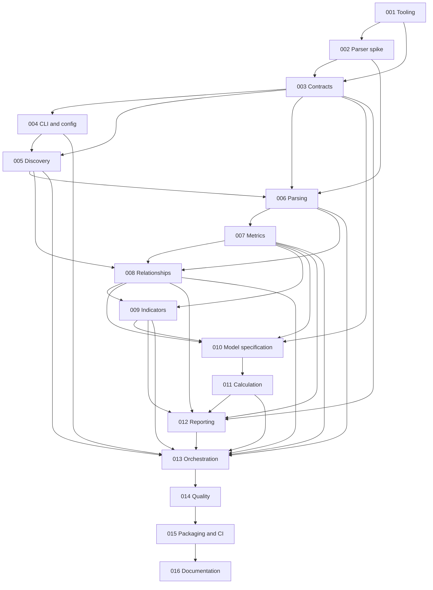

# Smart contract audit effort estimator — implementation plans

Prepared with the `improve` skill on **2026-10-14**. This package specifies the complete local-analysis MVP. Plan 001 has since been executed and reviewed in an isolated worktree; its implementation is committed as `60262bf` on `advisor/001-bootstrap-tooling` and remains unmerged. The remaining plans are planning material; no external issues have been published.

## Verified starting point

The inspected directory was empty. `ls -la` showed only `.` and `..`; `rg --files --hidden` found no files. `git rev-parse --short HEAD`, `git status`, and `git log` failed because this directory is not a Git repository. No README, source, tests, configuration, CI, design documents, or applicable ancestor `AGENTS.md` were found. There is **no planned-at commit SHA**, existing code exemplar, or verified build/test/lint command. Every implementation path and pnpm command below is **proposed**, not an existing capability.

The user approved planning for all MVP workstreams, overriding the skill's normal top-three-to-five selection and its default direction-only spike scope. There are no codebase bugs to report, and no nonexistent source evidence is manufactured. Source correctness, security, performance, and dependency advisories could not be audited because no implementation or lockfile exists.

## Product and acceptance boundary

Build a TypeScript CLI that estimates cumulative human **auditor-hours**, with a configurable conversion to auditor-days, from local Solidity sources. Its audience is audit firms, independent auditors, and teams preparing audit scopes. It supports one file, a contract directory, or a Foundry/Hardhat project. Estimates are reproducible, explainable planning ranges, not vulnerability findings, security assurance, commercial quotations, or elapsed delivery schedules.

MVP includes safe scope discovery, explicit include/exclude and ownership overrides, local import closure, supported-version parsing, source and syntax metrics, bounded relationship analysis, heuristic effort indicators, configurable deterministic estimates, terminal/JSON/Markdown reports, fixtures, tests, npm packaging, release preparation, and documentation. Markdown is retained in MVP: it reuses the result model and adds little complexity while making estimates reviewable.

Deferred: remote repositories, explorer/RPC inputs, solc/Slither execution, complete compiler-equivalent type resolution, advanced protocol recognition, remote dependency installation, other EVM languages, caches/databases, runtime AI, formal verification, price/proposal generation, and built-in calibration fitting. JSON plus exit codes enables basic CI use now; hosted actions, comment bots, and effort-regression policy integrations follow later. Public historical-data collection and model calibration are specified, not implemented, in plan 010.

## Recommended architecture

User-confirmed tooling review on **2026-10-14**: one npm package; Node 24.11+ only for development, CI and runtime (`>=24.11.0 <25`); pinned pnpm; TS7 for no-emit typechecking; tsdown for ESM compilation/bundling with external runtime dependencies. Use ESNext/bundler resolution, `.ts` source imports, strict TypeScript plus `noUncheckedIndexedAccess`/`exactOptionalPropertyTypes`, `verbatimModuleSyntax` and `isolatedDeclarations` with Oxc declaration generation. Type-aware oxlint/oxlint-tsgolint and oxfmt replace Biome. Tests live outside `src` under `test/`. Keep readonly records, explicit named exports/type imports, kebab-case filenames, two-space indentation and semicolons. Exact stable direct dependency and pnpm versions are pinned after compatibility verification; no framework, workspace monorepo or DI library.

```text
src/bin.ts                         executable shim only
src/cli/                           Commander commands, stdout/stderr, exit codes
src/config/                        JSON config, validation, override provenance
src/domain/                        versioned plain types, schemas, diagnostics
src/discovery/                     bounded traversal, safe reads, project metadata
src/parser/                        pinned Slang adapter, trusted child worker
src/metrics/                       lexical/source metrics, AST structural metrics
src/relationships/                 imports, ownership, inheritance and call edges
src/indicators/                    versioned heuristic rules and human prompts
src/estimation/                    pure model selection and calculation
src/reporting/                     terminal, stable JSON, Markdown
src/application/analyze.ts         orchestrates phases; no terminal calls
test/{unit,integration,e2e,...}/    committed, local, attributable fixtures
schemas/                           generated config/result JSON Schemas
docs/{adr,research,...}/            decisions, measurement and model contracts
```

Flow: validate input/config → discover scoped candidates → bounded reads → parse/extract declarations and imports → resolve local import closure → produce bounded semantic relationships → normalize measured metrics and evidence → classify indicators → calculate effort → format one result. The parser worker owns Slang handles and returns plain serializable records; the parent owns filesystem reads. The estimator imports neither Slang nor filesystem/CLI modules. The library entry exposes stable types plus `analyzeProject`, `estimateEffort`, and serialization; it must have no import-time I/O.

### Principal interfaces

- `resolveConfig(input, cliOverrides): Promise<ResolvedConfig>`: validated options with source provenance.
- `discoverScope(root, scopeOptions, limits): Promise<ScopeManifest>`: candidates, ownership, exclusions, roots, no parser calls.
- `readSource(fileRef, limits): Promise<SourceSnapshot>`: bounded UTF-8 bytes, hash, identity checks.
- `analyzeSources(snapshots, requests): Promise<SyntaxBatch>`: parser version, diagnostics, declarations, imports, tokens and syntactic counts; no filesystem access inside child.
- `resolveRelationships(manifest, snapshots, syntax, config): Promise<RelationshipResult>`: import closure and graph records, with resolution status.
- `classifyIndicators(analysis): Indicator[]` and `estimateEffort(estimateInput, model, manual): EstimateResult`: deterministic transforms.
- `formatTerminal/serializeJson/formatMarkdown(result): string`: pure rendering. CLI owns safe output-file creation.

Plan 003 freezes field names and schemas; prerequisite contracts are repeated where load-bearing in later plans. Function signatures may add typed cancellation/limit arguments without crossing these boundaries.

### Dependency decisions

| Dependency | Decision and rationale |
|---|---|
| `@nomicfoundation/slang` | Primary parser. Full-fidelity CST plus typed AST views is suitable for both comment-aware SLOC and syntax metrics. Binding capability is gated by plan 002; exact pin, reviewed upgrades. See [AST documentation](https://nomicfoundation.github.io/slang/latest/user-guide/05-syntax-trees/04-using-ast-types/). |
| `commander` | Lightweight command/help/argument layer with TypeScript definitions. Stable 15 is ESM and fits Node 22.12+. No interactive framework. See [upstream manifest](https://raw.githubusercontent.com/tj/commander.js/master/package.json). |
| `zod` 4 | One source for runtime validation, inferred types, and exported JSON Schemas. Validate untrusted JSON at boundaries. See [schema conversion](https://zod.dev/json-schema). |
| `picomatch` | Match normalized paths; Node filesystem APIs own traversal and symlink controls. No separate glob walker. Restrict supported patterns and lengths. See [upstream](https://github.com/micromatch/picomatch). |
| `smol-toml` | Data-only Foundry metadata parsing; never load executable config. See [upstream](https://github.com/squirrelchat/smol-toml). |
| TS7, tsdown, Vitest/V8, oxlint/oxlint-tsgolint, oxfmt, pnpm | TS7 checks types without emitting JavaScript; tsdown bundles project code into ESM with Oxc declarations and runtime dependencies external. Vitest tests source units separately from build-first integration/E2E/research suites. Oxlint provides type-aware linting; Oxfmt checks formatting. Exact compatible stable versions are verified and pinned during bootstrap. |

Use Node built-ins for hashing, filesystem, process control, paths, and text output. No solc, RPC clients, Hardhat/Foundry runtime dependencies, chalk, YAML config loader, config execution, ts-node, external service, graph framework, or pricing library. `@solidity-parser/parser` and compiler ASTs were evaluated and are not fallback dependencies; rationale and references are in [RESEARCH.md](RESEARCH.md).

## Confirmed bootstrap commands and outputs

- `pnpm test`: source units under `test/unit`, no build.
- `pnpm test:integration`: fresh tsdown build, then `test/integration`, `test/e2e` and `test/research` suites; packed-artifact suite excluded.
- `pnpm test:all`: units plus build-first integration suites.
- `pnpm test:coverage`: source unit tests with V8 coverage, no build.
- `pnpm typecheck`: TS7 `tsc --noEmit`; `pnpm lint`: `oxlint --type-aware`; `pnpm format:check`: `oxfmt --check`.
- `pnpm build`: tsdown; engine-derived target, source maps, no minification, clean only `dist`. Preserve `dist/index.js`/declarations, `dist/bin.js`/shebang and the separate future `dist/parser/worker.js` entry.
- Plan 015 adds the separate build-first `pnpm test:package` command and full `pnpm check` gate. No implementation command has run yet.

## Essential behavior decisions

**Scope and ownership.** Root is the explicit `--root`, otherwise directory target, otherwise the file target's parent. Do not search upward into unrelated workspaces. Default roots use explicit estimator config, data-only Foundry `profile.default`, then `src`/`contracts`, then the target directory. Hardhat markers identify conventions only; custom paths require estimator configuration. Record all choices. Scope and context are separate axes: ownership `first-party | third-party | unknown`; role `scoped | context | excluded`. Files outside selected scope can be imported as context. Dependencies never become scoped because they are imported. Including `lib` or `node_modules` requires deliberate ownership promotion before estimating their code.

**Commands.** `estimate <path>`, `inspect <path>`, `explain <path>`. `inspect` analyzes without effort; `explain` is estimate with full breakdown, not a second analysis implementation. Shared flags: repeatable `--include`, `--exclude`, `--root`, `--config`, `--no-config`, `--format terminal|json|markdown`, `--output`, `--force`, `--solidity-version`, `--allow-partial`, `--strict`, `--no-color`. Arrays from CLI replace the equivalent configurable list; default exclusions remain active unless `scope.defaultExcludes=false`. A literal file target bypasses source-root/include selection but still obeys explicit exclusions and ownership/safety constraints; default-excluded literal targets produce an actionable diagnostic unless the default policy is deliberately disabled.

**Configuration.** Only `audit-estimator.config.json` at the resolved root is auto-loaded; explicit config paths are operator-authorized reads. No JS/TS configs, parent/home search, interpolation, schema downloads, or implicit environment-variable options. Defaults → project metadata hints → estimator config → provided CLI values. Unknown estimator keys fail validation. Model parameters are strict, finite, bounded and versioned; manual adjustments require a reason. Config provenance and semantic option hashes appear in JSON.

**Failures.** Exit 0: usable complete output (ordinary warnings allowed); 1: unexpected internal defect; 2: usage/config; 3: nonexistent/unreadable target or no scoped Solidity; 4: incomplete/unsupported/limited analysis; 5: report-write failure; 130: SIGINT. `--allow-partial` permits a subset estimate and report, still exit 4. `--strict` promotes warnings to exit 4. With `--format json`, even expected errors use one versioned JSON envelope on stdout, diagnostics go to stderr, and no progress/color contaminates stdout.

**Completeness.** Report selected vs successfully parsed vs omitted scope. Malformed scoped files contribute physical lines only and no AST metrics or effort. A normal estimate is unavailable when selected source analysis is incomplete; partial mode produces `estimate.coverage="analyzed-subset"` and `fullScopeEstimate=null`. Missing context imports or unavailable required semantics also mark relationship coverage partial. Unknown function targets alone are normal documented capability limits, not invented zeroes or automatically fatal parse failures.

**Determinism.** Lexicographic code-point ordering, project-relative POSIX paths, semantic canonical JSON, byte hashes, separate parser/metrics/indicator/model/schema versions. No timestamps, absolute paths, performance samples, random IDs, locale sorting, filesystem order, or machine-specific stack traces in canonical results. Same supported completed analysis, bytes, semantic config, and component versions yields identical JSON. Resource/time exhaustion is an explicit failure, not a promise of identical outcomes on different hardware. Raw byte fingerprints can differ under CRLF; normalized metric content must obey specified newline equivalence.

**Untrusted input.** No shell, scripts, dynamic imports from analyzed roots, dependency fetching, source transmission, or runtime network access. Default discovery skips symlinks. Explicit `scope.followSymlinks=true` permits links resolving within the canonical root only, with identity deduplication. No outside-root sources in MVP. A fixed analyzer-owned child process isolates synchronous parser work and can be killed on a deadline; it is not a complete OS security sandbox. JavaScript heap caps do not cap WASM memory; bounded inputs/components and subprocess disposal are mandatory. Concurrent hostile filesystem mutation and hard total-RSS containment require an OS sandbox beyond the MVP guarantee.

## Estimation decision

Use a versioned additive work-breakdown model: fixed project preparation/synthesis allowance + per-file baseline review SLOC × hours/SLOC + bounded within-file complexity premiums + deduplicated contract interaction and dependency-boundary allowances + reasoned manual additions/discounts. Count shared physical files once, distinguish copied files by identity, and do not discount identical copies automatically. Counts of functions/contracts/LOC are reported but are not all separately weighted. Assembly and low-level-call adjustments share one group using a maximum; inheritance and calls share deduplicated directed endpoint pairs. Testing/coverage, access patterns, upgradeability, protocol novelty, custom cryptography, and business invariants are report/manual inputs rather than unvalidated automatic multipliers.

Plan 010 specifies formulas, exact starter assumptions, worked examples, range rounding, double-counting controls, and future calibration. All starter numbers are **invented engineering assumptions for an uncalibrated heuristic profile**, not industry coefficients. Ranges are low/high planning scenarios; no percentage accuracy or probability coverage is asserted. Auditor-days are effort divided by explicit hours/day (starter convention 8), not team delivery dates. Pricing remains separate and deferred.

## Execution order and status

Read the assigned plan completely. Resolve only its prerequisites, honor its file boundaries, run each gate, and update this table. Expected changes from completed dependencies are normal; incompatible contracts or unanticipated implementations require a report, not deletion. No plan authorizes publishing, pushing, account changes, or executing target-project scripts. S/M/L are coarse implementation sizes, not estimates of the audited contracts: S ≈ hours, M ≈ one to two days, L ≈ several days for implementation and review.

| Plan | Title | Priority | Effort | Risk | Depends on | Status |
|---|---|---|---|---|---|---|
| [001](001-bootstrap-tooling.md) | Bootstrap strict ESM tooling and verification | P1 | M | LOW | — | DONE — APPROVE on 2026-10-14 from `ce7955c`; independently verified in `/private/tmp/audit-estimator-001-worktree` on `advisor/001-bootstrap-tooling`; committed as `60262bf`, unmerged |
| [002](002-slang-compatibility-spike.md) | Prove Slang compatibility and semantic boundaries | P1 | M | MED | 001 | TODO |
| [003](003-domain-contracts-schemas.md) | Define domain contracts, diagnostics and schemas | P1 | M | MED | 001, 002 | TODO |
| [004](004-cli-configuration.md) | Define commands and safe configuration | P1 | M | MED | 003 | TODO |
| [005](005-safe-source-discovery.md) | Discover local scope with safe bounded reads | P1 | L | HIGH | 003, 004 | TODO |
| [006](006-parser-adapter-isolation.md) | Integrate version-aware isolated parsing | P1 | L | HIGH | 002, 003, 005 | TODO |
| [007](007-source-structural-metrics.md) | Extract reliable source and AST metrics | P1 | L | MED | 006 | TODO |
| [008](008-imports-inheritance-interactions.md) | Resolve local imports and bounded relationships | P1 | L | HIGH | 005, 006, 007 | TODO |
| [009](009-effort-indicators.md) | Classify evidence and human assessment inputs | P1 | M | MED | 007, 008 | TODO |
| [010](010-model-methodology-calibration.md) | Freeze heuristic methodology and calibration contract | P1 | M | HIGH | 003, 007, 008, 009 | TODO |
| [011](011-estimation-engine.md) | Implement pure deterministic effort calculation | P1 | M | HIGH | 010 | TODO |
| [012](012-terminal-json-markdown-reports.md) | Render terminal, JSON and Markdown reports | P1 | M | MED | 003, 007, 008, 009, 011 | TODO |
| [013](013-analysis-cli-orchestration.md) | Connect analysis and commands end to end | P1 | M | HIGH | 004–009, 011, 012 | TODO |
| [014](014-fixtures-adversarial-quality.md) | Complete independent, adversarial and platform verification | P1 | L | HIGH | 013 | TODO |
| [015](015-packaging-ci-release.md) | Package npm artifact and prepare secure CI/releases | P1 | M | MED | 014 | TODO |
| [016](016-documentation-release-readiness.md) | Document usage and satisfy release readiness | P1 | M | LOW | 015 | TODO |

Status values: TODO | IN PROGRESS | DONE | BLOCKED (reason) | REJECTED (rationale). Execute 001 through 016 sequentially for the simplest handoff. Once prerequisites land, unrelated work can be scheduled independently; this package does not require agent delegation. Plan 001 is reviewed DONE in its isolated worktree only; its changes must be integrated before dependent plans can execute from the main checkout.

### Plan 001 execution review — 2026-10-14

Verdict: **APPROVE**. Executor changes are committed as `60262bf` in `/private/tmp/audit-estimator-001-worktree`, branch `advisor/001-bootstrap-tooling`, based on `ce7955c`, following the user's commit instruction. Source/config/test/documentation changes stay within plan 001's scope. The advisor changed only this index in the main checkout and preserved unrelated operator additions; implementation was not merged, pushed or published.

Reviewer independently verified `pnpm install --frozen-lockfile` (unchanged lockfile hash), `pnpm typecheck`, `pnpm test:all` (one unit and three integration tests), `pnpm lint`, `pnpm format:check`, `pnpm build`, `pnpm test:coverage`, and built CLI `--help`/`--version`. Source units and coverage pass without `dist`; clean builds remove a stale artifact and produce byte-identical inventories. TS7 also accepts the generated declaration using `pnpm exec tsc --ignoreConfig --noEmit --strict --target ESNext --module ESNext --moduleResolution bundler dist/index.d.ts`. Coverage is a unit-only baseline, not CLI coverage; CLI behavior is checked by the integration suite.

Run verification from that worktree with `PATH=/Users/geovla/.nvm/versions/node/v24.21.0/bin:$PATH` to select Node 24.21.0 and pnpm 11.28.4. Exact tool pins and licenses are recorded in its `docs/dependencies.md`. tsdown uses explicit `.js` output and Oxc declarations. Application features and later plans were not implemented or audited in this execution.



Tests accompany every behavioral plan; 014 adds independent measurement oracles, metamorphic checks and cross-cutting adversarial cases. The parser spike must precede promised capabilities. Schemas precede consumers. Model specification must precede numerical code. Packed-artifact verification precedes public release readiness.

## Risks, assumptions and owner decisions

| Risk/assumption | Planned response |
|---|---|
| Slang docs and release support can differ; binding is not complete Solidity typing | Pin a researched release, query actual supported versions, prove API/fixtures, expose unresolved edges; stop if required minimum capabilities fail. |
| No trustworthy matched hours/scope calibration dataset established | Uncalibrated label, documented numbers, scenario ranges, manual context, consented historical calibration protocol; never convert public elapsed dates into exact hours. |
| SLOC depends on layout, cannot measure economic/business complexity | Stable definitions, layout metamorphic cases, explicitly human-assessed novelty/invariants, no accuracy claim. |
| Exclusions/ownership can hide legitimate code | Complete manifest and reasons, explicit promotions, missing first-party context notices; no implicit vendored scope. |
| pnpm symlinks/custom Foundry/Hardhat layouts | Default safe skips with diagnostics; inside-root symlink option and explicit roots/remappings; no executable config or hidden global settings. |
| WASM memory, pathological trees, huge closures | Byte/node/edge/file limits, subprocess deadlines, capped semantic components, failure reporting; no claim of hard OS memory containment. |
| Early public API/output compatibility | Independent schema/metric/model versions, generated schemas, additive-minor compatibility and breaking-major gates even while npm package is 0.x. |
| Package identity and governance absent | Provisional name `audit-estimator`, recommend MIT, maintainer supplies final npm scope/name, license approval, repository URL, security contact and release operator before publishing. |

Implementation planning needs no further input. **Actual release** requires owner confirmation of package identity/ownership, MIT versus another license, repository/security contact, and authorized release workflow. The starter heuristic profile can ship as visibly uncalibrated; a claim of accuracy requires matched historical data and independent evaluation. Do not block implementation just to choose commercial rates; pricing is deferred.

## Considered and rejected directions

- Generic codebase findings: absent implementation supplies no evidence.
- Running `forge config`, importing Hardhat config, or invoking solc: introduces analyzed-project execution/network risks for no MVP requirement.
- Runtime fallback parser chains: would create inconsistent metric semantics; revisit only after a failed Slang spike with a focused design amendment.
- Weighting every metric, vulnerability counts, ML/AI estimation, or transferring COCOMO coefficients: weak explainability or absent audit-specific validation.
- Automatic dependency trust, identical-copy discounts, perfect inherited-member/type resolution, calendar-duration promises: unsupported by local syntax evidence.
- Monorepo packages, plugins, DI containers, database persistence, custom bundling: extra maintenance before a demonstrated need.
- Universally default commercial rates or prices: effort and commercial quoting have different inputs and should remain separate.

Research is recorded in [RESEARCH.md](RESEARCH.md); each plan includes its own context and relevant references so an executor does not need this conversation.

## Planning-package verification

Checked all 16 numbered plans for required template sections, priority/effort/risk/dependencies/planning provenance, drift instructions and a verification gate at every step. Local Markdown links resolve, fences are balanced, plan dependencies precede their dependents, and all 16 status rows remain TODO. Independently checked the worked model totals and outward day rounding using exact rational arithmetic. The package contains 18 Markdown files, all under `plans/`; no implementation files or working verification commands were created or executed. Actual library compatibility, software tests, platform behavior and effort accuracy remain implementation/calibration gates, not completed results of this planning session.

Tooling review amendment (2026-10-14): plan 001 tooling choices and test separation were confirmed by the user and propagated through affected plans. All execution rows remain TODO; this amendment does not establish working software or successful runtime tests.
