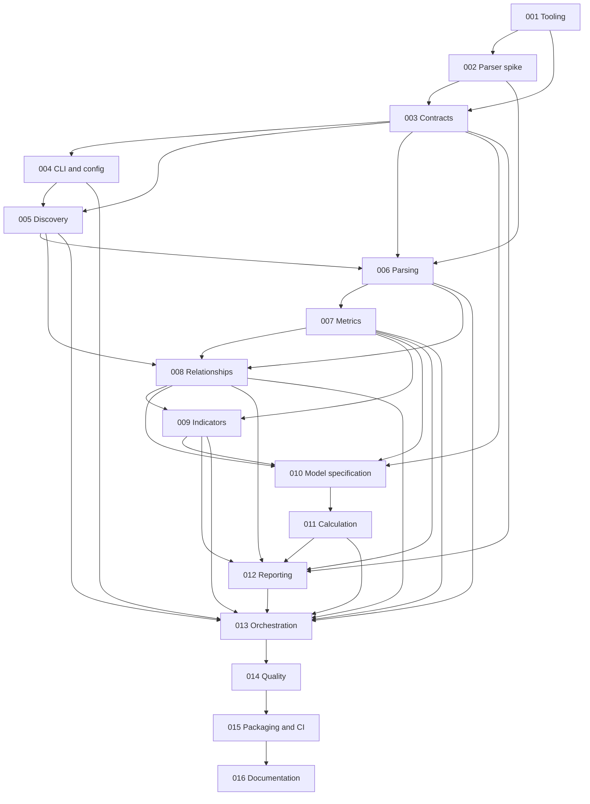

# Smart contract audit effort estimator — implementation plans

Prepared with the `improve` skill on **2026-10-14**; reconciled on **2026-10-15** against main commit `9b0bfe7`. This package specifies the local-analysis MVP. Plans **001–004 are reviewed, committed and merged into this checkout**. Plan **005 is reviewed, approved and committed as `7a93562` in its isolated worktree; it remains unmerged**. Plans **006–016 remain TODO** and have refreshed current-state contracts and drift baselines; 005 must be integrated before its dependents execute in this checkout. No external issues have been published. Historical execution reviews below remain the record of what was checked at the time; their original unmerged-worktree statements are superseded by the reconciliation evidence.

## Original planning starting point (2026-10-14)

The inspected directory was empty. `ls -la` showed only `.` and `..`; `rg --files --hidden` found no files. `git rev-parse --short HEAD`, `git status`, and `git log` failed because this directory is not a Git repository. No README, source, tests, configuration, CI, design documents, or applicable ancestor `AGENTS.md` were found. At that original survey there was **no planned-at commit SHA**, existing code exemplar, or verified build/test/lint command. That was the greenfield planning baseline; the reconciliation section records the implementation and commands that exist now.

The user approved planning for all MVP workstreams, overriding the skill's normal top-three-to-five selection and its default direction-only spike scope. The original survey had no implementation to audit. This reconciliation checks existing plans and their implementation evidence; it is not a new whole-codebase audit.

## Product and acceptance boundary

Build a TypeScript CLI that estimates cumulative human **auditor-hours**, with a configurable conversion to auditor-days, from local Solidity sources. Its audience is audit firms, independent auditors, and teams preparing audit scopes. It supports one file, a contract directory, or a Foundry/Hardhat project. Estimates are reproducible, explainable planning ranges, not vulnerability findings, security assurance, commercial quotations, or elapsed delivery schedules.

MVP includes safe scope discovery, explicit include/exclude and ownership overrides, local import closure, supported-version parsing, source and syntax metrics, bounded relationship analysis, heuristic effort indicators, configurable deterministic estimates, terminal/JSON/Markdown reports, fixtures, tests, npm packaging, release preparation, and documentation. Markdown is retained in MVP: it reuses the result model and adds little complexity while making estimates reviewable.

Deferred: remote repositories, explorer/RPC inputs, solc/Slither execution, complete compiler-equivalent type resolution, advanced protocol recognition, remote dependency installation, other EVM languages, caches/databases, runtime AI, formal verification, price/proposal generation, and built-in calibration fitting. JSON plus exit codes enables basic CI use now; hosted actions, comment bots, and effort-regression policy integrations follow later. Public historical-data collection and model calibration are specified, not implemented, in plan 010.

## Recommended architecture

User-confirmed tooling review on **2026-10-14**: one npm package; Node 24.11+ only for development, CI and runtime (`>=24.11.0 <25`); pinned pnpm; TS7 for no-emit typechecking; tsdown for ESM compilation/bundling with external runtime dependencies. Use ESNext/bundler resolution, `.ts` source imports, strict TypeScript plus `noUncheckedIndexedAccess`/`exactOptionalPropertyTypes`, `verbatimModuleSyntax` and `isolatedDeclarations` with Oxc declaration generation. Type-aware oxlint/oxlint-tsgolint and oxfmt replace Biome. Tests live outside `src` under `test/`. Keep readonly records, explicit named exports/type imports, kebab-case filenames, two-space indentation and semicolons. Exact stable direct dependency and pnpm versions are pinned after compatibility verification; no framework, workspace monorepo or DI library.

```text
src/bin.ts                         executable shim only
src/cli/                           Commander commands, stdout/stderr, exit codes
src/config/                        JSON config, validation, override provenance
src/domain/                        versioned plain types, schemas, diagnostics
src/discovery/                     bounded traversal, safe reads, project metadata
src/parser/                        pinned Slang adapter, trusted child worker
src/metrics/                       lexical/source metrics, AST structural metrics
src/relationships/                 imports, ownership, inheritance and call edges
src/indicators/                    versioned heuristic rules and human prompts
src/estimation/                    pure model selection and calculation
src/reporting/                     terminal, stable JSON, Markdown
src/application/analyze.ts         orchestrates phases; no terminal calls
test/{unit,integration,e2e,...}/    committed, local, attributable fixtures
schemas/                           generated config/result JSON Schemas
docs/{adr,research,...}/            decisions, measurement and model contracts
```

Flow: validate input/config → discover scoped candidates → bounded reads → parse/extract declarations and imports → resolve local import closure → produce bounded semantic relationships → normalize measured metrics and evidence → classify indicators → calculate effort → format one result. The parser worker owns Slang handles and returns plain serializable records; the parent owns filesystem reads. The estimator imports neither Slang nor filesystem/CLI modules. The library entry exposes stable types plus `analyzeProject`, `estimateEffort`, and serialization; it must have no import-time I/O.

### Principal interfaces

- `resolveConfig(input, cliOverrides): Promise<ResolvedConfig>`: validated options with source provenance.
- `discoverScope(root, scopeOptions, limits): Promise<ScopeManifest>`: candidates, ownership, exclusions, roots, no parser calls.
- `readSource(fileRef, limits): Promise<SourceSnapshot>`: bounded UTF-8 bytes, hash, identity checks.
- `analyzeSources(snapshots, requests): Promise<SyntaxBatch>`: parser version, diagnostics, declarations, imports, tokens and syntactic counts; no filesystem access inside child.
- `resolveRelationships(manifest, snapshots, syntax, config): Promise<RelationshipResult>`: import closure and graph records, with resolution status.
- `classifyIndicators(analysis): Indicator[]` and `estimateEffort(estimateInput, model, manual): EstimateResult`: deterministic transforms.
- `formatTerminal/serializeJson/formatMarkdown(result): string`: pure rendering. CLI owns safe output-file creation.

Plan 003 freezes field names and schemas; prerequisite contracts are repeated where load-bearing in later plans. Function signatures may add typed cancellation/limit arguments without crossing these boundaries.

### Dependency decisions

| Dependency | Decision and rationale |
|---|---|
| `@nomicfoundation/slang` | Primary parser. Full-fidelity CST plus typed AST views is suitable for both comment-aware SLOC and syntax metrics. Binding capability is gated by plan 002; exact pin, reviewed upgrades. See [AST documentation](https://nomicfoundation.github.io/slang/latest/user-guide/05-syntax-trees/04-using-ast-types/). |
| `commander` | Lightweight command/help/argument layer with TypeScript definitions. Stable 15 is ESM and fits Node 22.12+. No interactive framework. See [upstream manifest](https://raw.githubusercontent.com/tj/commander.js/master/package.json). |
| `zod` 4 | One source for runtime validation, inferred types, and exported JSON Schemas. Validate untrusted JSON at boundaries. See [schema conversion](https://zod.dev/json-schema). |
| `picomatch` | Match normalized paths; Node filesystem APIs own traversal and symlink controls. No separate glob walker. Restrict supported patterns and lengths. See [upstream](https://github.com/micromatch/picomatch). |
| `smol-toml` | Data-only Foundry metadata parsing; never load executable config. See [upstream](https://github.com/squirrelchat/smol-toml). |
| TS7, tsdown, Vitest/V8, oxlint/oxlint-tsgolint, oxfmt, pnpm | TS7 checks types without emitting JavaScript; tsdown bundles project code into ESM with Oxc declarations and runtime dependencies external. Vitest tests source units separately from build-first integration/E2E/research suites. Oxlint provides type-aware linting; Oxfmt checks formatting. Exact compatible stable versions are verified and pinned during bootstrap. |

Use Node built-ins for hashing, filesystem, process control, paths, and text output. No solc, RPC clients, Hardhat/Foundry runtime dependencies, chalk, YAML config loader, config execution, ts-node, external service, graph framework, or pricing library. `@solidity-parser/parser` and compiler ASTs were evaluated and are not fallback dependencies; rationale and references are in [RESEARCH.md](RESEARCH.md).

## Confirmed bootstrap commands and outputs

- `pnpm test`: source units under `test/unit`, no build.
- `pnpm test:integration`: fresh tsdown build, then `test/integration`, `test/e2e` and `test/research` suites; packed-artifact suite excluded.
- `pnpm test:all`: units plus build-first integration suites.
- `pnpm test:coverage`: source unit tests with V8 coverage, no build.
- `pnpm typecheck`: TS7 `tsc --noEmit`; `pnpm lint`: `oxlint --type-aware`; `pnpm format:check`: `oxfmt --check`.
- `pnpm build`: tsdown; engine-derived target, source maps, no minification, clean only `dist`. Preserve `dist/index.js`/declarations, `dist/bin.js`/shebang and the separate future `dist/parser/worker.js` entry.
- Plan 015 adds the separate build-first `pnpm test:package` command and full `pnpm check` gate. These later scripts remain unimplemented; existing commands and current verification limits are recorded in the reconciliation section.

## Essential behavior decisions

**Scope and ownership.** Root is the explicit `--root`, otherwise directory target, otherwise the file target's parent. Do not search upward into unrelated workspaces. Default roots use explicit estimator config, data-only Foundry `profile.default`, then `src`/`contracts`, then the target directory. Hardhat markers identify conventions only; custom paths require estimator configuration. Record all choices. Scope and context are separate axes: ownership `first-party | third-party | unknown`; role `scoped | context | excluded`. Files outside selected scope can be imported as context. Dependencies never become scoped because they are imported. Including `lib` or `node_modules` requires deliberate ownership promotion before estimating their code.

**Commands.** `estimate <path>`, `inspect <path>`, `explain <path>`. `inspect` analyzes without effort; `explain` is estimate with full breakdown, not a second analysis implementation. Shared flags: repeatable `--include`, `--exclude`, `--root`, `--config`, `--no-config`, `--format terminal|json|markdown`, `--output`, `--force`, `--solidity-version`, `--allow-partial`, `--strict`, `--no-color`. Arrays from CLI replace the equivalent configurable list; default exclusions remain active unless `scope.defaultExcludes=false`. A literal file target bypasses source-root/include selection but still obeys explicit exclusions and ownership/safety constraints; default-excluded literal targets produce an actionable diagnostic unless the default policy is deliberately disabled.

**Configuration.** Only `audit-estimator.config.json` at the resolved root is auto-loaded; explicit config paths are operator-authorized reads. No JS/TS configs, parent/home search, interpolation, schema downloads, or implicit environment-variable options. Defaults → project metadata hints → estimator config → provided CLI values. Unknown estimator keys fail validation. Model parameters are strict, finite, bounded and versioned; manual adjustments require a reason. Config provenance and semantic option hashes appear in JSON.

**Failures.** Exit 0: usable complete output (ordinary warnings allowed); 1: unexpected internal defect; 2: usage/config; 3: nonexistent/unreadable target or no scoped Solidity; 4: incomplete/unsupported/limited analysis; 5: report-write failure; 130: SIGINT. `--allow-partial` permits a subset estimate and report, still exit 4. `--strict` promotes warnings to exit 4. With `--format json`, even expected errors use one versioned JSON envelope on stdout, diagnostics go to stderr, and no progress/color contaminates stdout.

**Completeness.** Report selected vs successfully parsed vs omitted scope. Malformed scoped files contribute physical lines only and no AST metrics or effort. A normal estimate is unavailable when selected source analysis is incomplete; partial mode produces `estimate.coverage="analyzed-subset"` and `fullScopeEstimate=null`. Missing context imports or unavailable required semantics also mark relationship coverage partial. Unknown function targets alone are normal documented capability limits, not invented zeroes or automatically fatal parse failures.

**Determinism.** Lexicographic code-point ordering, project-relative POSIX paths, semantic canonical JSON, byte hashes, separate parser/metrics/indicator/model/schema versions. No timestamps, absolute paths, performance samples, random IDs, locale sorting, filesystem order, or machine-specific stack traces in canonical results. Same supported completed analysis, bytes, semantic config, and component versions yields identical JSON. Resource/time exhaustion is an explicit failure, not a promise of identical outcomes on different hardware. Raw byte fingerprints can differ under CRLF; normalized metric content must obey specified newline equivalence.

**Untrusted input.** No shell, scripts, dynamic imports from analyzed roots, dependency fetching, source transmission, or runtime network access. Default discovery skips symlinks. Explicit `scope.followSymlinks=true` permits links resolving within the canonical root only, with identity deduplication. No outside-root sources in MVP. A fixed analyzer-owned child process isolates synchronous parser work and can be killed on a deadline; it is not a complete OS security sandbox. JavaScript heap caps do not cap WASM memory; bounded inputs/components and subprocess disposal are mandatory. Concurrent hostile filesystem mutation and hard total-RSS containment require an OS sandbox beyond the MVP guarantee.

## Estimation decision

Use a versioned additive work-breakdown model: fixed project preparation/synthesis allowance + per-file baseline review SLOC × hours/SLOC + bounded within-file complexity premiums + deduplicated contract interaction and dependency-boundary allowances + reasoned manual additions/discounts. Count shared physical files once, distinguish copied files by identity, and do not discount identical copies automatically. Counts of functions/contracts/LOC are reported but are not all separately weighted. Assembly and low-level-call adjustments share one group using a maximum; inheritance and calls share deduplicated directed endpoint pairs. Testing/coverage, access patterns, upgradeability, protocol novelty, custom cryptography, and business invariants are report/manual inputs rather than unvalidated automatic multipliers.

Plan 010 specifies formulas, exact starter assumptions, worked examples, range rounding, double-counting controls, and future calibration. All starter numbers are **invented engineering assumptions for an uncalibrated heuristic profile**, not industry coefficients. Ranges are low/high planning scenarios; no percentage accuracy or probability coverage is asserted. Auditor-days are effort divided by explicit hours/day (starter convention 8), not team delivery dates. Pricing remains separate and deferred.

## Execution order and status

Read the assigned plan completely. Resolve only its prerequisites, honor its file boundaries, run each gate, and update this table. Expected changes from completed dependencies are normal; incompatible contracts or unanticipated implementations require a report, not deletion. No plan authorizes publishing, pushing, account changes, or executing target-project scripts. S/M/L are coarse implementation sizes, not estimates of the audited contracts: S ≈ hours, M ≈ one to two days, L ≈ several days for implementation and review.

| Plan | Title | Priority | Effort | Risk | Depends on | Status |
|---|---|---|---|---|---|---|
| [001](001-bootstrap-tooling.md) | Bootstrap strict ESM tooling and verification | P1 | M | LOW | — | DONE — reviewed `60262bf`, merged `ee639aa`; 2026-10-15 static spot-check at `9b0bfe7`, bootstrap source unit passes; full re-verification pending environment repair |
| [002](002-slang-compatibility-spike.md) | Prove Slang compatibility and semantic boundaries | P1 | M | MED | 001 | DONE — reviewed `fea9ef2`, merged `1c51195`; 2026-10-15 research/fixtures/report unchanged; runtime re-verification blocked by missing Slang; approved BOM amendment retained |
| [003](003-domain-contracts-schemas.md) | Define domain contracts, diagnostics and schemas | P1 | M | MED | 001, 002 | DONE — reviewed `ea9f788`, merged `5ddb655`; 2026-10-15 domain/schemas unchanged; runtime re-verification blocked by missing Zod |
| [004](004-cli-configuration.md) | Define commands and safe configuration | P1 | M | MED | 003 | DONE — reviewed `4f93e23`, merged `9b0bfe7`; 2026-10-15 CLI/config unchanged; runtime re-verification blocked by missing Commander/Zod |
| [005](005-safe-source-discovery.md) | Discover local scope with safe bounded reads | P1 | L | HIGH | 003, 004 | DONE — APPROVE after two revision rounds, 2026-10-15; committed `7a93562` in `/private/tmp/audit-estimator-005-worktree`, branch `advisor/005-safe-source-discovery`; integration pending |
| [006](006-parser-adapter-isolation.md) | Integrate version-aware isolated parsing | P1 | L | HIGH | 002, 003, 005 | TODO — plan reviewed/tightened at `ba9a136`, 2026-10-15; 005 is merged in this checkout; frozen-install/runtime baseline required |
| [007](007-source-structural-metrics.md) | Extract reliable source and AST metrics | P1 | L | MED | 006 | TODO |
| [008](008-imports-inheritance-interactions.md) | Resolve local imports and bounded relationships | P1 | L | HIGH | 005, 006, 007 | TODO |
| [009](009-effort-indicators.md) | Classify evidence and human assessment inputs | P1 | M | MED | 007, 008 | TODO |
| [010](010-model-methodology-calibration.md) | Freeze heuristic methodology and calibration contract | P1 | M | HIGH | 003, 007, 008, 009 | TODO |
| [011](011-estimation-engine.md) | Implement pure deterministic effort calculation | P1 | M | HIGH | 010 | TODO |
| [012](012-terminal-json-markdown-reports.md) | Render terminal, JSON and Markdown reports | P1 | M | MED | 003, 007, 008, 009, 011 | TODO |
| [013](013-analysis-cli-orchestration.md) | Connect analysis and commands end to end | P1 | M | HIGH | 004–009, 011, 012 | TODO |
| [014](014-fixtures-adversarial-quality.md) | Complete independent, adversarial and platform verification | P1 | L | HIGH | 013 | TODO |
| [015](015-packaging-ci-release.md) | Package npm artifact and prepare secure CI/releases | P1 | M | MED | 014 | TODO |
| [016](016-documentation-release-readiness.md) | Document usage and satisfy release readiness | P1 | M | LOW | 015 | TODO |

Status values: TODO | IN PROGRESS | DONE | BLOCKED (reason) | REJECTED (rationale). Execute 001 through 016 sequentially for the simplest handoff. Once prerequisites land, unrelated work can be scheduled independently; this package does not require agent delegation. Plan 001 is merged into the main checkout; its implementation files are unchanged between `60262bf` and the plan 002 execution base `2077848`.

## Reconciliation — 2026-10-15 at `9b0bfe7`

The initial checkout was clean. `git log` and `git worktree list` confirm all four implementation branches are integrated; their retained worktrees are historical review artifacts, not active IN PROGRESS work. There are no currently BLOCKED or stale IN PROGRESS rows. The earlier Plan 002 BLOCK verdict was resolved by its resumed APPROVE review and is not a live blocker.

### Completed-plan spot-checks

- **001:** Node `24.21.0`, pnpm `11.28.4`, version constant, compiler settings and formatting/lint configurations remain present. `git diff 60262bf HEAD -- src/version.ts tsconfig.json .node-version .oxlintrc.json .oxfmtrc.json` is empty. Package/bin/test infrastructure has intentionally evolved under 002–004. The bootstrap source unit passed (1 test).
- **002:** `git diff fea9ef2 HEAD -- test/research test/fixtures/parser docs/research/slang-spike.md` is empty. Slang is still pinned to `1.3.9`. The report and fixtures preserve the approved BOM mapping, ambiguous binding results and child-isolation limitations. The research suite was not rerun because its installed dependency is missing.
- **003:** `git diff ea9f788 HEAD -- src/domain schemas` is empty. The domain DTOs, strict producer schemas, generated artifacts and forward-reader policy remain intact. Domain tests failed collection due to missing Zod, so current runtime/schema verification is pending.
- **004:** `git diff 4f93e23 HEAD -- src/cli src/config test/integration/config.test.ts` is empty. Commander remains pinned to `15.0.0`; ADR 003 and the unavailable-handler shim still match the reviewed implementation. CLI unit tests failed collection due to missing Commander/Zod; configuration integration was not rerun.

These are **historical DONE approvals with a limited current spot-check**, not a claim that every done criterion passes today. No source, dependency manifest, lockfile or tool configuration was changed during reconciliation.

### Verification limits and execution preflight

| Check | Current result |
| --- | --- |
| `node --version`, `pnpm --version` | `v24.21.0`, `11.28.4` |
| `pnpm typecheck` | Fails: unresolved Commander, Zod and Slang imports; resulting secondary type errors are not adjudicated as independent source bugs |
| `pnpm lint` | Fails: missing dependency types propagate error types into semantic rules |
| `pnpm test` | 1 bootstrap test passes; domain and CLI suites fail collection on missing runtime packages |
| `pnpm format:check` | Fails on the same four `.agents/skills/improve` Markdown files recorded by earlier reviews |
| Fresh build/integration, schemas, coverage, frozen install | Not rerun; missing dependencies prevent a meaningful runtime gate |
| Source/artifact comparisons to reviewed commits | Empty diffs for the paths above |

Pnpm attempted automatic dependency verification/installation before each script, reported a store-location mismatch and `ERR_PNPM_ABORTED_REMOVE_MODULES_DIR_NO_TTY`, then ran the script with missing runtime packages. No explicit install or dependency repair was performed. The temporary local store created by that attempted verification was removed; it was absent at the start. Do not force a modules purge as part of a read-only reconciliation.

Before executing another plan, obtain a successful `pnpm install --frozen-lockfile` in the authorized implementation checkout. Once dependencies are correctly installed, `pnpm --config.verifyDepsBeforeRun=false run <script>` avoids implicit installation when running checks. That option does not fix a missing dependency. Re-run typecheck, lint and unit checks after installation. The four-file inherited formatting exception remains explicit and narrowly scoped; any new formatting failure still blocks approval. Fixing those skill files belongs to a separate authorized change, not an unnoticed expansion of feature scope.

### Refreshed backlog and ordering

All twelve TODO plans were read and refreshed in place at `9b0bfe7`; no duplicate plans were created. Their implementation stages remain absent, so **no TODO finding was rejected as fixed independently**. No old plan was retired and dependency ordering is unchanged.

- **005:** Ready by code prerequisites (003/004 merged), subject to the installation/check preflight. Reuses existing config defaults, grammar validation and identity helpers. Clarifies lexical symlink checks, path-root ownership overrides, original-text snapshots and internal discovery observations without fabricated manifest hashes.
- **006–009:** Wait for their existing prerequisites. Refreshes distinguish internal parser/metadata/readiness records from strict public DTOs and preserve the actual Slang capability limits and version provenance.
- **010–013:** Wait for measurement/model prerequisites. Refreshes align input/ledger/envelope fields with the merged contracts, make application eligibility filtering explicit and prevent invented public fields. Unrepresentable required structured output still requires a focused schema amendment; it must not be silently omitted.
- **014–016:** Wait for the application/quality/package chain. Existing tests, fixture provenance, build-first wrapper and current private package state replace the original empty-directory assumptions. Public release identity, licensing, account setup and remote matrix evidence remain pending.

**Next executable plan: [005 — safe source discovery](005-safe-source-discovery.md), after environment preflight.** Plans 006–016 are not ready to execute now. Nothing in this reconciliation authorizes implementation, publication or execution of analyzed-project code.

Scope of this run: plan reconciliation, merged-artifact spot-checks and the four inexpensive checks above. No new correctness/security/performance sweep, dependency advisory research, production parser review, calibration assessment, packaging validation or cross-platform run was performed.

### Plan 006 review — 2026-10-15

Reviewed and tightened against `ba9a136`. **Implementation remains TODO.** This commit merges reviewed 005 (`7a93562`), superseding the older unmerged-005 statements for the 006 handoff. No source, tests, dependency pins or tool configuration were changed by this review.

The review addressed these concrete handoff gaps. Confidence is HIGH for the cited contract mismatches; effort/risk below describes the plan correction, not implementation of the whole parser.

| Priority | Gap addressed | Evidence | Impact | Effort | Correction risk |
|---|---|---|---|---|---|
| P1 | Worker inventory change omitted from scope | `test/integration/bootstrap-cli.test.ts:24`, `tsdown.config.ts:4` | Adding the required worker would fail the artifact gate with no authorized test adjustment. Added a strict recursive inventory update. | S | LOW |
| P1 | Missing presentation-coordinate conversion | `src/domain/schemas.ts:79`, `docs/adr/002-domain-contract.md:11`, `test/research/slang-source-view.ts:36` | Correct BOM offsets could still produce invalid/off-by-one public evidence. Specified one-based scalar conversion and hand oracles. | S | LOW |
| P1 | Raw parser handoff confused with completed metrics | `src/domain/types.ts:144`, `src/domain/types.ts:376`, `src/discovery/scope.ts:137` | A zero-context executor could fabricate metrics or extend frozen public schemas. Defined internal session/results and manifest/snapshot identity matching. | S | MED — future consumers must inspect the implemented companion API |
| P1 | Inference and global-budget coverage unspecified | `src/discovery/budget.ts:85`, `src/config/defaults.ts:24`, `docs/research/slang-spike.md` | Parent inference or a fresh parser deadline would defeat cancellation/application limits. Kept all Slang in child, shared absolute deadline, persistent counters and distinct cancellation. | S | MED — explicit killed-job accounting can reduce remaining coverage |
| P1 | Transport bounds and lifecycle tests underspecified | Original `plans/006-parser-adapter-isolation.md:75` and `:85` at `ba9a136`; `test/research/slang-child.ts:39` is research-only | Bounds applied only after deserialization would not bound incoming frames. Specified pre-decode framing limits, cleanup, private helper seam and real native-worker coverage. | S | MED — bounded framing adds implementation work |
| P2 | Stale prerequisite/install facts and non-build-first commands | `ba9a136`, `scripts/test.mjs`, `package.json` | Executor could wait for merged work or run stale artifacts. Refreshed prerequisite evidence and runnable ordered gates with the exact inherited format exception. | S | LOW |

Fresh-context read-only review found three additional ambiguities, all addressed: parent validation now checks the per-file cutoff as well as the application budget; each wire request explicitly contains one file; and generic events have a fixed shape, initial vocabulary and concrete field bounds. A bounded startup handshake makes the Step 3 initialization gate independent of Step 4 extraction. Native Node self-resolution was probed successfully to the planned `dist/index.js` and `dist/parser/worker.js` URLs; this does not prove those artifacts or WASM load.

Scope was the parser plan and its immediate source/domain/discovery/config/build/test contracts, local ADRs and Slang spike evidence. This was not a whole-codebase audit, dependency-advisory check, semantic binding implementation or runtime/platform certification. A read-only probe confirms Node `24.21.0` and missing installed runtime dependencies (Slang, Commander, Zod, picomatch, smol-toml); no install, build or software tests were run. Execution must establish a frozen-install baseline and run all stated gates. The reviewed architecture remains a subprocess policy boundary, not a hard RSS/OS sandbox; that documented limitation was considered and retained.

### Plan 005 review — 2026-10-15

Reviewed and tightened [005](005-safe-source-discovery.md) at `9b0bfe7`; implementation remains **TODO**, after the existing installation/check preflight. Review was limited to the discovery plan, current domain/config contracts, trusted test runner and direct downstream handoffs. Existing local changes to the planning package were preserved; no source, dependencies or tool configuration were changed.

| Finding addressed in the plan | Impact | Amendment effort | Amendment risk | Confidence | Evidence |
| --- | --- | --- | --- | --- | --- |
| Whole-directory allocation precedes traversal limits | Large directories could allocate beyond the entry budget | S | LOW; preserves completed-run ordering | HIGH | 005 Step 4 now uses bounded nonrecursive `opendir` rather than whole-directory `readdir` |
| Metadata safety depends on a later reader step | Metadata could bypass source confinement/open/byte checks | S | MED; bootstrap metadata policy becomes explicit | HIGH | 005 Steps 1–2 now share the safe primitive, reject bootstrap metadata links and retain validated Foundry libs for 008 |
| Alias deduplication lacks ownership/representative rules | Encounter order could change eligibility, identity or later import accounting | M | MED; conservative conflicts require explicit promotion | HIGH | 005 Steps 4–5 define observed-alias classification, stable representatives and shared registry/budget tests |
| Selection and manifest obligations conflict with existing DTOs | Executors could invent hashes/fields or widen selected scope | S | LOW; follows existing schema/config boundaries | HIGH | `src/domain/types.ts` `FileScopeEntry`/`ScopeManifest`; 005 internal observations and selection table |
| Direct integration test commands bypass the required wrapper | Gates could omit the fresh build or diverge from repository policy | S | LOW | HIGH | `AGENTS.md`, `scripts/test.mjs`; all 005 integration gates now use `pnpm test:integration` |

The revision also removes invented generated-file suffix defaults, requires literal glob semantics and actual abort delivery, preserves BOM text explicitly, and aligns the full drift-path list with scope. Verification of this documentation review consists of Markdown structure/local-link checks and `git diff --check`; runtime, install and platform gates remain executor work. Plans are intentionally excluded by `.oxfmtrc.json`, so a targeted Oxfmt invocation that selects no files is not counted as a passing format check. Schema expansion and blanket hardlink rejection were considered and rejected: existing internal observations and observed-identity grouping preserve the agreed boundary without those changes.

### Plan 005 execution review — 2026-10-15

Verdict: **APPROVE** after two revision rounds. The separate executor implemented safe discovery in `/private/tmp/audit-estimator-005-worktree`, branch `advisor/005-safe-source-discovery`, based on `9b0bfe7`, which contains the merged prerequisites. All 21 implementation paths are within plan 005's scope. The worktree also contains a byte-identical copy of the primary checkout's previously amended 005 plan; that copy is preserved planning context, not a new implementation edit. At the user’s subsequent request, the reviewed implementation and amended 005 plan were committed as `7a93562` on `advisor/005-safe-source-discovery`; the worktree is clean and the commit remains **unmerged**. No push or publication occurred. The advisor changed only this index in the primary checkout and preserved all existing local plan edits.

The implementation adds eight internal discovery modules: shared immutable limits and cumulative budgets, lexical/physical containment, bounded descriptor-based reads, frozen hardlink identities, data-only Foundry metadata, literal segment matching, deterministic bounded directory traversal, and structured selection/ownership observations. Exact pins are Picomatch `4.0.7`, smol-toml `1.9.0`, and development-only `@types/picomatch` `4.0.3`; installed manifests confirm their licenses, Node compatibility, and absence of install-time hooks. The lifecycle allowlist is unchanged. Domain/config contracts, public exports, generated schemas and build/test configuration are unchanged. ADR 004 documents how 008/013 reuse the reader, registry and budget, including operational-config resolution before metadata and explicit late-alias ownership re-evaluation.

Reviewer inspected source, tests, dependency/fixture provenance and the complete implementation scope, and independently passed `pnpm install --frozen-lockfile` with a before/after lockfile hash check, `pnpm typecheck`, `pnpm lint`, the six pattern units, fresh-build focused integration (46 tests), fresh-build `pnpm test:all` (32 unit plus 73 integration/research tests), `pnpm schemas:check`, targeted changed-artifact formatting, and `git diff --check`. Production output remains the existing seven allowlisted artifacts. A separate native Node boundary probe confirmed exact source-byte ceilings and shared unique-file limits.

Review revisions addressed a flaky deadline test found by the independent full-suite run, quadratic work in large hardlink groups, cancellation delivery during ownership finalization, explicit capability skips, regular-file remapping contexts/targets, and manifest/snapshot/provenance checks across every completed discovery result in the test suite. Other reviewed regressions cover metadata path suffix preservation, literal/include precedence, default-exclusion opt-out, root/target intersection, alias ownership conflicts and promotions, source mutation/growth, special files, descriptor cleanup, budget tightening/mismatch, and context-read accounting. No analyzed-project configuration or scripts were executed.

Accepted inherited deviation: full `pnpm format:check` fails solely on the same four unchanged `.agents/skills/improve` Markdown files recorded by prior reviews; all changed implementation artifacts independently pass formatting. Runtime verification is limited to Darwin arm64 with Node `24.21.0` and pnpm `11.28.4`; no capability skips occurred in the final unfiltered suites. Windows and other filesystems remain unverified. The safe reader assumes a stable local snapshot and documents Node's lack of atomic open-beneath confinement against hostile concurrent filesystem mutation. This execution did not audit or implement later analysis stages. Plan 006 requires a checkout containing the reviewed 005 implementation.

### Plan 001 execution review — 2026-10-14

Verdict: **APPROVE**. Executor changes are committed as `60262bf` in `/private/tmp/audit-estimator-001-worktree`, branch `advisor/001-bootstrap-tooling`, based on `ce7955c`, following the user's commit instruction. Source/config/test/documentation changes stay within plan 001's scope. The advisor changed only this index in the main checkout and preserved unrelated operator additions; implementation was not merged, pushed or published.

Reviewer independently verified `pnpm install --frozen-lockfile` (unchanged lockfile hash), `pnpm typecheck`, `pnpm test:all` (one unit and three integration tests), `pnpm lint`, `pnpm format:check`, `pnpm build`, `pnpm test:coverage`, and built CLI `--help`/`--version`. Source units and coverage pass without `dist`; clean builds remove a stale artifact and produce byte-identical inventories. TS7 also accepts the generated declaration using `pnpm exec tsc --ignoreConfig --noEmit --strict --target ESNext --module ESNext --moduleResolution bundler dist/index.d.ts`. Coverage is a unit-only baseline, not CLI coverage; CLI behavior is checked by the integration suite.

Run verification from that worktree with `PATH=/Users/geovla/.nvm/versions/node/v24.21.0/bin:$PATH` to select Node 24.21.0 and pnpm 11.28.4. Exact tool pins and licenses are recorded in its `docs/dependencies.md`. tsdown uses explicit `.js` output and Oxc declarations. Application features and later plans were not implemented or audited in this execution.

### Plan 002 execution review — 2026-10-14

Verdict: **BLOCK**. Execution drift check passed from `2077848`; prerequisite 001 is merged and no conflicting parser experiment existed. The separate executor pinned `@nomicfoundation/slang@1.3.9` and preserved two original encoding fixtures, five focused tests, dependency evidence and `docs/research/slang-spike.md` in `/private/tmp/audit-estimator-002-worktree` (detached HEAD, uncommitted). All seven changed/added files stay within plan 002's scope; production source is unchanged. No merge, push, publication or commit occurred.

Reviewer independently reproduced that a leading BOM makes an otherwise parseable declaration invalid, produces a whole-input diagnostic and is omitted by `tree.unparse()`. Plain and CRLF/Unicode inputs reconstruct exactly in the tested cases. This violates Step 2's required BOM reconstruction gate under its no-source-rewriting rule. The partial tests assert the observed failure; their passing result does not satisfy the minimum capability contract. The full syntax matrix/fixture manifest, semantic binding matrix and child isolation remain uncompleted.

Independent checks passed: `pnpm install --frozen-lockfile`, `pnpm list @nomicfoundation/slang --depth 0`, `pnpm typecheck`, `pnpm lint`, fresh-build `pnpm test:all` (one unit and eight integration/research tests), targeted format checks for changed artifacts, and `git diff --check`. Full `pnpm format:check` fails on four unchanged files under `.agents/skills/improve` introduced before this execution; no out-of-scope formatting fix was made. The build is exercised by `pnpm test:all`.

The user subsequently approved analyzer-owned BOM decoding while preserving original bytes and exact offset mapping. Plans 002 and 006 now specify the narrow exception, original-coordinate mapping and required tests. Execution resumed in the same worktree; downstream parser/graph capability promises must wait for the amended spike to finish. Slang columns count Unicode scalar values, independently verified with an emoji before a same-line identifier; UTF-16 offsets remain a separate coordinate.

### Plan 002 resumed execution review — 2026-10-14

Verdict: **APPROVE**. The amended spike completed in `/private/tmp/audit-estimator-002-worktree`, based on `2077848`. The runtime Slang 1.3.9 pin, dependency inventory, research report, hand-reviewed manifest, 23 original parser fixtures and three research TypeScript files were committed at the user's request as `fea9ef2` on `advisor/002-slang-compatibility-spike` and remain unmerged. The named research-only BOM helper was explicitly added to plan scope. Production source and trusted tool configuration are unchanged. The 31-file staged scope and CRLF-aware whitespace check passed; the two encoding fixtures retain their intentional CRLF bytes. The implementation worktree is clean after the commit.

Reviewer read the implementation, exact target-location assertions and capability report, checked all fixture byte/line expectations independently, and reran `pnpm install --frozen-lockfile`, `pnpm list @nomicfoundation/slang --depth 0`, `pnpm typecheck`, `pnpm lint`, targeted changed-artifact formatting, `git diff --check` and fresh-build `pnpm test:all`. The full suite passed one unit and eighteen integration/research tests (nineteen total, including fifteen research tests). The installed version listing required access to pnpm's protected store database and passed on review. Build output contains only production entries; test child output remains in ignored `.vitest/`.

The approved BOM decoder strips one initial prefix only from parser views, preserves bytes/hashes, reconstructs exactly and maps range endpoints to original UTF-8/UTF-16/scalar-column coordinates. The semantic matrix proves tested namespace/direct inheritance identities and preserves alias/overload candidate sets, unresolved imports and dynamic-target limitations. Invalid dependencies and incompatible version components require explicit production gates. Plain built ESM child loading, malformed-input survival, repeated batches, serialization loss and a parent deadline followed by kill/reap are verified. Advisory memory samples do not establish hard WASM/RSS limits.

Accepted documented deviation: full `pnpm format:check` fails solely on four unchanged skill files under `.agents/skills/improve`; changed artifacts pass. This unrelated baseline failure does not invalidate the completed research gates and was not fixed outside scope. Plan 003 can execute against a checkout containing the reviewed 002 artifacts; the main checkout still needs their integration. Production BOM implementation belongs to plan 006, whose instructions now include the approved contract.

### Plan 003 execution review — 2026-10-15

Verdict: **APPROVE** after one revision round. The separate executor implemented the domain contracts in `/private/tmp/audit-estimator-003-worktree`, based on `1c51195`, which includes the merged 001 and 002 prerequisites. All 19 changed or added files stay within plan 003's implementation scope. At the user's subsequent request, the reviewed implementation was committed as `ea9f788` on `advisor/003-domain-contracts-schemas`; it remains unmerged. No push or publication occurred. The advisor changed only this index in the main checkout. Plan 004 requires a checkout containing these reviewed 003 artifacts.

The implementation adds readonly branded identities and DTOs, measured/unavailable records, bounded configuration/model validation, stable diagnostics, complete/partial/error envelopes, independent versions, canonical JSON and framed SHA-256 helpers. Three committed Draft 2020-12 schema artifacts are generated from temporary built ESM without changing the production build boundary. Zod is pinned to `4.4.3`; its MIT license and absence of install-time lifecycle hooks were checked against the installed manifest. No numerical model coefficients, parser implementation or configuration filesystem loader were added.

Reviewer independently passed `pnpm install --frozen-lockfile`, `pnpm typecheck`, `pnpm lint`, the 15-test domain suite, and fresh-build `pnpm test:all` (16 unit plus 18 integration/research tests). The emitted `dist/index.d.ts` also passed strict standalone TypeScript validation. `pnpm schemas:check` preserved schema bytes and modification times; two `pnpm schemas:generate` runs produced byte-identical files. An intentional schema drift was rejected without rewriting the altered file, which was restored afterward. Scope inspection and `git diff --check` passed.

Review regressions cover traversal in prefixed IDs, ordered original-source coordinates, directed pair deduplication, disjoint scope roles, prototype-like config keys, unavailable values, signed manual ledger ranges, required resolved targets, report completeness and partial-estimate coverage labels. Populated fixtures exercise contracts, callables, relationships, indicators and estimates; schema round trips check structural validation. ADR 002 documents the distinction between structural JSON Schema validation and additional runtime cross-field checks, alongside evidence, ownership, version and forward-reader policies.

Accepted inherited deviation: full `pnpm format:check` fails solely on the same four unchanged files under `.agents/skills/improve`; changed artifacts pass. The unrelated skill files were preserved. This execution did not audit or implement later plans.

### Plan 004 execution review — 2026-10-15

Verdict: **APPROVE**. The separate executor implemented CLI and data-only configuration contracts in `/private/tmp/audit-estimator-004-worktree`, branch `advisor/004-cli-configuration`, based on `5ddb655`, which contains the merged 001–003 prerequisites. All 18 changed or added implementation files are within plan 004's scope. At the user's subsequent request, the reviewed implementation was committed as `4f93e23`; it remains unmerged. No push or publication occurred. The advisor changed only this index in the primary checkout.

The change adds local Commander 15.0.0 programs with injected handlers and streams, explicit option provenance, predictable validation and exit statuses, bounded UTF-8 JSON loading, automatic-config symlink rejection, documented explicit-config symlink reads, physical root confinement, deterministic layered merging and semantic hashes. Complete trusted model defaults remain an injected input; no coefficients or fabricated estimates were introduced. ADR 003 records precedence, path ownership, operational limits, glob grammar and the read policy. Analysis remains unavailable until plan 013.

Reviewer inspected the implementation, fixtures and tests, and independently passed `pnpm install --frozen-lockfile --offline`, `pnpm typecheck`, `pnpm lint`, fresh-build `pnpm test:all` (26 unit and 27 integration/research tests), `pnpm schemas:check`, changed-artifact formatting, built estimate/inspect help and `git diff --check`. A separate native-Node dispatch check verified `--no-config`. The executor also passed the ordinary frozen install and focused command/config gates. Schema artifacts and production build configuration are unchanged; the build emits only the existing seven allowlisted files.

Review feedback produced regression coverage for mixed-diagnostic exit priority, redacted known errors, unsupported glob syntax hidden by later overrides, physical source/remapping/coverage confinement, config-directory-relative paths, external explicit config/symlink reads, root selection, no parent search, schema/limit boundaries and semantic hash independence from presentation. CLI error classes were placed in a lightweight in-scope module to avoid importing configuration schemas into the CLI bundle and emitting an extra shared chunk. The bootstrap artifact test was preserved.

Accepted inherited deviation: full `pnpm format:check` fails solely on the same four unchanged `.agents/skills/improve` files recorded by prior reviews; every changed artifact passes. This execution did not implement or audit later analysis stages. Plan 005 requires a checkout containing this reviewed implementation.



Tests accompany every behavioral plan; 014 adds independent measurement oracles, metamorphic checks and cross-cutting adversarial cases. The parser spike must precede promised capabilities. Schemas precede consumers. Model specification must precede numerical code. Packed-artifact verification precedes public release readiness.

## Risks, assumptions and owner decisions

| Risk/assumption | Planned response |
|---|---|
| Slang docs and release support can differ; binding is not complete Solidity typing | Pin a researched release, query actual supported versions, prove API/fixtures, expose unresolved edges; stop if required minimum capabilities fail. |
| No trustworthy matched hours/scope calibration dataset established | Uncalibrated label, documented numbers, scenario ranges, manual context, consented historical calibration protocol; never convert public elapsed dates into exact hours. |
| SLOC depends on layout, cannot measure economic/business complexity | Stable definitions, layout metamorphic cases, explicitly human-assessed novelty/invariants, no accuracy claim. |
| Exclusions/ownership can hide legitimate code | Complete manifest and reasons, explicit promotions, missing first-party context notices; no implicit vendored scope. |
| pnpm symlinks/custom Foundry/Hardhat layouts | Default safe skips with diagnostics; inside-root symlink option and explicit roots/remappings; no executable config or hidden global settings. |
| WASM memory, pathological trees, huge closures | Byte/node/edge/file limits, subprocess deadlines, capped semantic components, failure reporting; no claim of hard OS memory containment. |
| Early public API/output compatibility | Independent schema/metric/model versions, generated schemas, additive-minor compatibility and breaking-major gates even while npm package is 0.x. |
| Package identity and governance absent | Provisional name `audit-estimator`, recommend MIT, maintainer supplies final npm scope/name, license approval, repository URL, security contact and release operator before publishing. |

Implementation planning needs no further input. **Actual release** requires owner confirmation of package identity/ownership, MIT versus another license, repository/security contact, and authorized release workflow. The starter heuristic profile can ship as visibly uncalibrated; a claim of accuracy requires matched historical data and independent evaluation. Do not block implementation just to choose commercial rates; pricing is deferred.

## Considered and rejected directions

- Generic codebase findings: absent implementation supplies no evidence.
- Running `forge config`, importing Hardhat config, or invoking solc: introduces analyzed-project execution/network risks for no MVP requirement.
- Runtime fallback parser chains: would create inconsistent metric semantics; revisit only after a failed Slang spike with a focused design amendment.
- Weighting every metric, vulnerability counts, ML/AI estimation, or transferring COCOMO coefficients: weak explainability or absent audit-specific validation.
- Automatic dependency trust, identical-copy discounts, perfect inherited-member/type resolution, calendar-duration promises: unsupported by local syntax evidence.
- Monorepo packages, plugins, DI containers, database persistence, custom bundling: extra maintenance before a demonstrated need.
- Universally default commercial rates or prices: effort and commercial quoting have different inputs and should remain separate.

Research is recorded in [RESEARCH.md](RESEARCH.md); each plan includes its own context and relevant references so an executor does not need this conversation.

## Planning-package verification

Checked all 16 numbered plans for required template sections, priority/effort/risk/dependencies/planning provenance, drift instructions and a verification gate at every step. Local Markdown links resolve, fences are balanced, plan dependencies precede their dependents, and all 16 status rows were TODO at original planning; see the reconciled status table for current state. Independently checked the worked model totals and outward day rounding using exact rational arithmetic. At original planning the package contained 18 Markdown files, all under `plans/`; that planning session created no implementation or working verification commands. Actual library compatibility, software tests, platform behavior and effort accuracy remain implementation/calibration gates, not completed results of this planning session.

Tooling review amendment (2026-10-14): plan 001 tooling choices and test separation were confirmed by the user and propagated through affected plans. All execution rows were TODO at that amendment; it did not establish working software or successful runtime tests.
