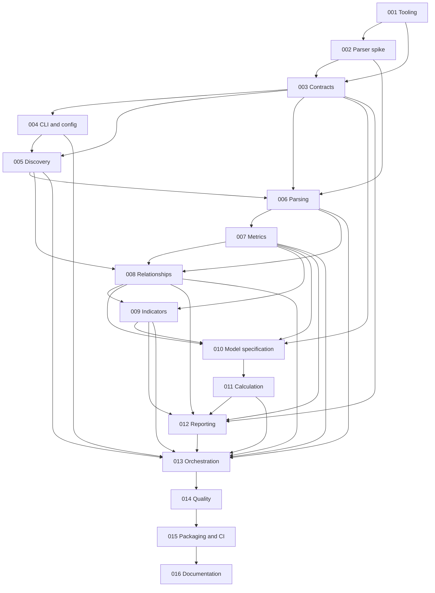

# Smart contract audit effort estimator — implementation plans

Prepared with the `improve` skill on **2026-10-14**. **Latest scoped plan review: 2026-10-16 at `a42129f`, for [016](016-documentation-release-readiness.md). HEAD contains 013 (`4a2100e`) and 014 (`a42129f`); their historical unmerged notes below are superseded by that commit evidence. Next prerequisite is [015](015-packaging-ci-release.md), whose implementation is absent; 016 remains TODO.** This review did not edit 015; inspect its live specification and prerequisite implementation before execution. **Update 2026-10-16: 015 executed and APPROVED on branch `advisor/015-packaging-ci-release` (head `20b02c0`, base `9261789`), not yet merged. See the 015 row. 016 becomes executable once 015 is merged.** The previous broad reconciliation was 2026-10-15 at `5077f1f`.

The previous broad reconciliation recorded passing typecheck, lint, formatting, **429 unit tests**, **215 fresh-build integration/research tests**, and schema consistency; those are historical results, not new verification by the 016 review. Frozen install, coverage, dependency advisories and Linux/Windows were not rerun. This is backlog reconciliation, not a new whole-codebase audit. Historical review and worktree notes below are retained; the status table and latest reconciliation supersede their old integration/prerequisite statements. No external issues have been published.

## Original planning starting point (2026-10-14)

The inspected directory was empty. `ls -la` showed only `.` and `..`; `rg --files --hidden` found no files. `git rev-parse --short HEAD`, `git status`, and `git log` failed because this directory is not a Git repository. No README, source, tests, configuration, CI, design documents, or applicable ancestor `AGENTS.md` were found. At that original survey there was **no planned-at commit SHA**, existing code exemplar, or verified build/test/lint command. That was the greenfield planning baseline; the reconciliation section records the implementation and commands that exist now.

The user approved planning for all MVP workstreams, overriding the skill's normal top-three-to-five selection and its default direction-only spike scope. The original survey had no implementation to audit. This reconciliation checks existing plans and their implementation evidence; it is not a new whole-codebase audit.

## Product and acceptance boundary

Build a TypeScript CLI that estimates cumulative human **auditor-hours**, with a configurable conversion to auditor-days, from local Solidity sources. Its audience is audit firms, independent auditors, and teams preparing audit scopes. It supports one file, a contract directory, or a Foundry/Hardhat project. Estimates are reproducible, explainable planning ranges, not vulnerability findings, security assurance, commercial quotations, or elapsed delivery schedules.

MVP includes safe scope discovery, explicit include/exclude and ownership overrides, local import closure, supported-version parsing, source and syntax metrics, bounded relationship analysis, heuristic effort indicators, configurable deterministic estimates, terminal/JSON/Markdown reports, fixtures, tests, npm packaging, release preparation, and documentation. Markdown is retained in MVP: it reuses the result model and adds little complexity while making estimates reviewable.

Deferred: remote repositories, explorer/RPC inputs, solc/Slither execution, complete compiler-equivalent type resolution, advanced protocol recognition, remote dependency installation, other EVM languages, caches/databases, runtime AI, formal verification, price/proposal generation, and built-in calibration fitting. JSON plus exit codes enables basic CI use now; hosted actions, comment bots, and effort-regression policy integrations follow later. Public historical-data collection and model calibration are specified, not implemented, in plan 010.

## Recommended architecture

User-confirmed tooling review on **2026-10-14**: one npm package; Node 24.11+ only for development, CI and runtime (`>=24.11.0 <25`); pinned pnpm; TS7 for no-emit typechecking; tsdown for ESM compilation/bundling with external runtime dependencies. Use ESNext/bundler resolution, `.ts` source imports, strict TypeScript plus `noUncheckedIndexedAccess`/`exactOptionalPropertyTypes`, `verbatimModuleSyntax` and `isolatedDeclarations` with Oxc declaration generation. Type-aware oxlint/oxlint-tsgolint and oxfmt replace Biome. Tests live outside `src` under `test/`. Keep readonly records, explicit named exports/type imports, kebab-case filenames, two-space indentation and semicolons. Exact stable direct dependency and pnpm versions are pinned after compatibility verification; no framework, workspace monorepo or DI library.

```text
src/bin.ts                         executable shim only
src/cli/                           Commander commands, stdout/stderr, exit codes
src/config/                        JSON config, validation, override provenance
src/domain/                        versioned plain types, schemas, diagnostics
src/discovery/                     bounded traversal, safe reads, project metadata
src/parser/                        pinned Slang adapter, trusted child worker
src/metrics/                       lexical/source metrics, AST structural metrics
src/relationships/                 imports, ownership, inheritance and call edges
src/indicators/                    versioned heuristic rules and human prompts
src/estimation/                    pure model selection and calculation
src/reporting/                     terminal, stable JSON, Markdown
src/application/analyze.ts         orchestrates phases; no terminal calls
test/{unit,integration,e2e,...}/    committed, local, attributable fixtures
schemas/                           generated config/result JSON Schemas
docs/{adr,research,...}/            decisions, measurement and model contracts
```

Flow: validate input/config → discover scoped candidates → bounded reads → parse/extract declarations and imports → resolve local import closure → produce bounded semantic relationships → normalize measured metrics and evidence → classify indicators → calculate effort → format one result. The parser worker owns Slang handles and returns plain serializable records; the parent owns filesystem reads. The estimator imports neither Slang nor filesystem/CLI modules. The library entry exposes stable types plus `analyzeProject`, `estimateEffort`, and serialization; it must have no import-time I/O.

### Principal interfaces

- `resolveConfig(input, cliOverrides): Promise<ResolvedConfig>`: validated options with source provenance.
- `discoverScope(root, scopeOptions, limits): Promise<ScopeManifest>`: candidates, ownership, exclusions, roots, no parser calls.
- `readSource(fileRef, limits): Promise<SourceSnapshot>`: bounded UTF-8 bytes, hash, identity checks.
- `analyzeSources(snapshots, requests): Promise<SyntaxBatch>`: parser version, diagnostics, declarations, imports, tokens and syntactic counts; no filesystem access inside child.
- `resolveRelationships(manifest, snapshots, syntax, config): Promise<RelationshipResult>`: import closure and graph records, with resolution status.
- `classifyIndicators(input: IndicatorInput): IndicatorClassification` and the planned `estimateEffort(input: EstimateInput): EstimateResult | null`: deterministic transforms. EstimateInput embeds the effective model and manual adjustments; `selectModel()` in 011 supplies fresh starter defaults.
- `formatTerminal/serializeJson/formatMarkdown(result): string`: pure rendering. CLI owns safe output-file creation.

Plan 003 freezes field names and schemas; prerequisite contracts are repeated where load-bearing in later plans. Function signatures may add typed cancellation/limit arguments without crossing these boundaries.

### Dependency decisions

| Dependency | Decision and rationale |
|---|---|
| `@nomicfoundation/slang` | Primary parser. Full-fidelity CST plus typed AST views is suitable for both comment-aware SLOC and syntax metrics. Binding capability is gated by plan 002; exact pin, reviewed upgrades. See [AST documentation](https://nomicfoundation.github.io/slang/latest/user-guide/05-syntax-trees/04-using-ast-types/). |
| `commander` | Lightweight command/help/argument layer with TypeScript definitions. Stable 15 is ESM and fits Node 22.12+. No interactive framework. See [upstream manifest](https://raw.githubusercontent.com/tj/commander.js/master/package.json). |
| `zod` 4 | One source for runtime validation, inferred types, and exported JSON Schemas. Validate untrusted JSON at boundaries. See [schema conversion](https://zod.dev/json-schema). |
| `picomatch` | Match normalized paths; Node filesystem APIs own traversal and symlink controls. No separate glob walker. Restrict supported patterns and lengths. See [upstream](https://github.com/micromatch/picomatch). |
| `smol-toml` | Data-only Foundry metadata parsing; never load executable config. See [upstream](https://github.com/squirrelchat/smol-toml). |
| TS7, tsdown, Vitest/V8, oxlint/oxlint-tsgolint, oxfmt, pnpm | TS7 checks types without emitting JavaScript; tsdown bundles project code into ESM with Oxc declarations and runtime dependencies external. Vitest tests source units separately from build-first integration/E2E/research suites. Oxlint provides type-aware linting; Oxfmt checks formatting. Exact compatible stable versions are verified and pinned during bootstrap. |

Use Node built-ins for hashing, filesystem, process control, paths, and text output. No solc, RPC clients, Hardhat/Foundry runtime dependencies, chalk, YAML config loader, config execution, ts-node, external service, graph framework, or pricing library. `@solidity-parser/parser` and compiler ASTs were evaluated and are not fallback dependencies; rationale and references are in [RESEARCH.md](RESEARCH.md).

## Confirmed bootstrap commands and outputs

- `pnpm test`: source units under `test/unit`, no build.
- `pnpm test:integration`: fresh tsdown build, then `test/integration`, `test/e2e` and `test/research` suites; packed-artifact suite excluded.
- `pnpm test:all`: units plus build-first integration suites.
- `pnpm test:coverage`: source unit tests with V8 coverage, no build.
- `pnpm typecheck`: TS7 `tsc --noEmit`; `pnpm lint`: `oxlint --type-aware`; `pnpm format:check`: `oxfmt --check`.
- `pnpm build`: tsdown; engine-derived target, source maps, no minification, clean only `dist`. Preserve `dist/index.js`/declarations, `dist/bin.js`/shebang and the separate future `dist/parser/worker.js` entry.
- Plan 015 adds the separate build-first `pnpm test:package` command and full `pnpm check` gate. These later scripts remain unimplemented; existing commands and current verification limits are recorded in the reconciliation section.

## Essential behavior decisions

**Scope and ownership.** Root is the explicit `--root`, otherwise directory target, otherwise the file target's parent. Do not search upward into unrelated workspaces. Default roots use explicit estimator config, data-only Foundry `profile.default`, then `src`/`contracts`, then the target directory. Hardhat markers identify conventions only; custom paths require estimator configuration. Record all choices. Scope and context are separate axes: ownership `first-party | third-party | unknown`; role `scoped | context | excluded`. Files outside selected scope can be imported as context. Dependencies never become scoped because they are imported. Including `lib` or `node_modules` requires deliberate ownership promotion before estimating their code.

**Commands.** `estimate <path>`, `inspect <path>`, `explain <path>`. `inspect` analyzes without effort; `explain` is estimate with full breakdown, not a second analysis implementation. Shared flags: repeatable `--include`, `--exclude`, `--root`, `--config`, `--no-config`, `--format terminal|json|markdown`, `--output`, `--force`, `--solidity-version`, `--allow-partial`, `--strict`, `--no-color`. Arrays from CLI replace the equivalent configurable list; default exclusions remain active unless `scope.defaultExcludes=false`. A literal file target bypasses source-root/include selection but still obeys explicit exclusions and ownership/safety constraints; default-excluded literal targets produce an actionable diagnostic unless the default policy is deliberately disabled.

**Configuration.** Only `audit-estimator.config.json` at the resolved root is auto-loaded; explicit config paths are operator-authorized reads. No JS/TS configs, parent/home search, interpolation, schema downloads, or implicit environment-variable options. Defaults → project metadata hints → estimator config → provided CLI values. Unknown estimator keys fail validation. Model parameters are strict, finite, bounded and versioned; manual adjustments require a reason. Config provenance and semantic option hashes appear in JSON.

**Failures.** Exit 0: usable complete output (ordinary warnings allowed); 1: unexpected internal defect; 2: usage/config; 3: nonexistent/unreadable target or no scoped Solidity; 4: incomplete/unsupported/limited analysis; 5: report-write failure; 130: SIGINT. `--allow-partial` permits a subset estimate and report, still exit 4. `--strict` promotes warnings to exit 4. With `--format json`, even expected errors use one versioned JSON envelope on stdout, diagnostics go to stderr, and no progress/color contaminates stdout.

**Completeness.** Report selected vs successfully parsed vs omitted scope. Malformed scoped files contribute physical lines only and no AST metrics or effort. A normal estimate is unavailable when selected source analysis is incomplete; partial mode produces `estimate.coverage="analyzed-subset"` and `fullScopeEstimate=null`. Missing context imports or unavailable required semantics also mark relationship coverage partial. Unknown function targets alone are normal documented capability limits, not invented zeroes or automatically fatal parse failures.

**Determinism.** Lexicographic code-point ordering, project-relative POSIX paths, semantic canonical JSON, byte hashes, separate parser/metrics/indicator/model/schema versions. No timestamps, absolute paths, performance samples, random IDs, locale sorting, filesystem order, or machine-specific stack traces in canonical results. Same supported completed analysis, bytes, semantic config, and component versions yields identical JSON. Resource/time exhaustion is an explicit failure, not a promise of identical outcomes on different hardware. Raw byte fingerprints can differ under CRLF; normalized metric content must obey specified newline equivalence.

**Untrusted input.** No shell, scripts, dynamic imports from analyzed roots, dependency fetching, source transmission, or runtime network access. Default discovery skips symlinks. Explicit `scope.followSymlinks=true` permits links resolving within the canonical root only, with identity deduplication. No outside-root sources in MVP. A fixed analyzer-owned child process isolates synchronous parser work and can be killed on a deadline; it is not a complete OS security sandbox. JavaScript heap caps do not cap WASM memory; bounded inputs/components and subprocess disposal are mandatory. Concurrent hostile filesystem mutation and hard total-RSS containment require an OS sandbox beyond the MVP guarantee.

## Estimation decision

Use a versioned additive work-breakdown model: fixed project preparation/synthesis allowance + per-file baseline review SLOC × hours/SLOC + bounded within-file complexity premiums + deduplicated contract interaction and dependency-boundary allowances + reasoned manual additions/discounts. Count shared physical files once, distinguish copied files by identity, and do not discount identical copies automatically. Counts of functions/contracts/LOC are reported but are not all separately weighted. Assembly and low-level-call adjustments share one group using a maximum; inheritance and calls share deduplicated directed endpoint pairs. Testing/coverage, access patterns, upgradeability, protocol novelty, custom cryptography, and business invariants are report/manual inputs rather than unvalidated automatic multipliers.

Plan 010 specifies formulas, exact starter assumptions, worked examples, range rounding, double-counting controls, and future calibration. All starter numbers are **invented engineering assumptions for an uncalibrated heuristic profile**, not industry coefficients. Ranges are low/high planning scenarios; no percentage accuracy or probability coverage is asserted. Auditor-days are effort divided by explicit hours/day (starter convention 8), not team delivery dates. Pricing remains separate and deferred.

## Execution order and status

Read the assigned plan completely. Resolve only its prerequisites, honor its file boundaries, run each gate, and update this table. Expected changes from completed dependencies are normal; incompatible contracts or unanticipated implementations require a report, not deletion. No plan authorizes publishing, pushing, account changes, or executing target-project scripts. S/M/L are coarse implementation sizes, not estimates of the audited contracts: S ≈ hours, M ≈ one to two days, L ≈ several days for implementation and review.

| Plan | Title | Priority | Effort | Risk | Depends on | Status |
|---|---|---|---|---|---|---|
| [001](001-bootstrap-tooling.md) | Bootstrap strict ESM tooling and verification | P1 | M | LOW | — | DONE — reviewed `60262bf`, merged `ee639aa`; **spot-verified 2026-10-15 at `5077f1f`** (type/lint/format, source units, fresh-build integration/research and schema checks pass; install/coverage not rerun) |
| [002](002-slang-compatibility-spike.md) | Prove Slang compatibility and semantic boundaries | P1 | M | MED | 001 | DONE — reviewed `fea9ef2`, merged `1c51195`; **spot-verified 2026-10-15 at `5077f1f`** (type/lint/format, source units, fresh-build integration/research and schema checks pass; install/coverage not rerun) |
| [003](003-domain-contracts-schemas.md) | Define domain contracts, diagnostics and schemas | P1 | M | MED | 001, 002 | DONE — reviewed `ea9f788`, merged `5ddb655`; **spot-verified 2026-10-15 at `5077f1f`** (type/lint/format, source units, fresh-build integration/research and schema checks pass; install/coverage not rerun) |
| [004](004-cli-configuration.md) | Define commands and safe configuration | P1 | M | MED | 003 | DONE — reviewed `4f93e23`, merged `9b0bfe7`; **spot-verified 2026-10-15 at `5077f1f`** (type/lint/format, source units, fresh-build integration/research and schema checks pass; install/coverage not rerun) |
| [005](005-safe-source-discovery.md) | Discover local scope with safe bounded reads | P1 | L | HIGH | 003, 004 | DONE — APPROVE after two revision rounds; `7a93562` merged `ba9a136`; **spot-verified 2026-10-15 at `5077f1f`** (type/lint/format, source units, fresh-build integration/research and schema checks pass; install/coverage not rerun) |
| [006](006-parser-adapter-isolation.md) | Integrate version-aware isolated parsing | P1 | L | HIGH | 002, 003, 005 | DONE — APPROVE after two extraction revision rounds; `2a04649` fast-forwarded onto `main`; **spot-verified 2026-10-15 at `5077f1f`** (type/lint/format, source units, fresh-build integration/research and schema checks pass; install/coverage not rerun) |
| [007](007-source-structural-metrics.md) | Extract reliable source and AST metrics | P1 | L | MED | 006 | DONE — reviewed `892073d`, present on `main`; **spot-verified 2026-10-15 at `5077f1f`** (type/lint/format, source units, fresh-build integration/research and schema checks pass; install/coverage not rerun) |
| [008](008-imports-inheritance-interactions.md) | Resolve local imports and bounded relationships | P1 | L | HIGH | 005, 006, 007 | DONE — reviewed `2eb8d3d`, now present on `main`; **spot-verified 2026-10-15 at `5077f1f`** (type/lint/format, source units, fresh-build integration/research and schema checks pass; install/coverage not rerun) |
| [009](009-effort-indicators.md) | Classify evidence and human assessment inputs | P1 | L | MED | 007, 008 | DONE — reviewed `ab0f67c` `cec7271` `2bfade3`, present on `main`; **spot-verified 2026-10-15 at `5077f1f`** (indicator/LCOV units, readiness/reader integration pass) |
| [010](010-model-methodology-calibration.md) | Freeze heuristic methodology and calibration contract | P1 | M | HIGH | 003, 007, 008, 009 | DONE — APPROVED first round; `d012fb9` is present on `main`; **spot-verified 2026-10-15 at `5077f1f`** (37 spec tests, full source/integration suites and schema checks pass) |
| [011](011-estimation-engine.md) | Implement pure deterministic effort calculation | P1 | M | HIGH | 010 | DONE — APPROVED first round; `69101d5` is present on `main`; **spot-verified 2026-10-15 at `5077f1f`** (frozen numerical/eligibility/error cases, bounds/properties, native API/purity, full source/integration and schema gates pass). Original worktree review retained below |
| [012](012-terminal-json-markdown-reports.md) | Render terminal, JSON and Markdown reports | P1 | M | MED | 003, 007, 008, 009, 011 | DONE — APPROVE after one bounded revision; reviewed `ce9c1a3`, integrated as `5077f1f` with identical source/test/docs/formatter contents; **spot-verified 2026-10-15 at `5077f1f`** (26 reporting tests, native API/purity, goldens, full source/integration and schema gates pass). Original execution record retained below |
| [013](013-analysis-cli-orchestration.md) | Connect analysis and commands end to end | P1 | L | HIGH | 004–009, 011, 012 | DONE — APPROVED first round (2026-10-15); worktree commit `4a2100e` on branch `worktree-agent-a35ad480552946973` (base `5c1effa`), **not yet merged**. Reviewer re-ran all gates: typecheck/lint/format, 469 unit + 259 integration/e2e, `schemas:check`, manual JSON estimate (`complete`, `fullScopeEstimate` = `estimate`), done-criteria greps, out-of-scope diff empty. Findings: `invalid-total` is reachable from config (per-entry validation only) and keeps its table row; built-CLI SIGINT deferred to 014 (API-level abort test with a real stalled child passes); dist inventory became `analyze.js`/`version-policy.js` chunks. **Follow-up → 014:** pre-existing racy parser-worker deadline test is masked by an 8 s `staggerStart` in 013's tests; 014 must fix the race and remove the stagger |
| [014](014-fixtures-adversarial-quality.md) | Complete independent, adversarial and platform verification | P1 | L | HIGH | 013 | DONE — APPROVED 2026-10-16 after one bounded revision (duplicate unit test removed). Resumed in `/private/tmp/audit-estimator-014-worktree` (detached, base `4a2100e`), **uncommitted, not merged**. Reviewer re-ran: typecheck/lint/format/schemas, `boundaries:check` + `--self-test` (31 controls, TS 7.0.2), `test:coverage` with four enforced thresholds, `test:all` (497 unit + 274 integration); confirmed 10/10 consecutive green full integration logs in `.vitest/plan014/`; empty `src`/lockfile/schema/model diff; `staggerStart` removed. Built-CLI SIGINT completed via test-only `--import` preload. Follow-ups: unit test `traverses long chains and large diamonds iteratively under a reduced allowance` timed out once at 5 s under an all-projects parallel JSON run (not in gated commands); new fixtures carry provisional `MIT (proposed)` pending 015 licensing |
| [015](015-packaging-ci-release.md) | Package npm artifact and prepare secure CI/releases | P1 | M | MED | 014 | DONE (local preparation) — APPROVED first round, 2026-10-16. Branch `advisor/015-packaging-ci-release` (commits `e9e5427`..`20b02c0` on base `9261789`) in worktree `.claude/worktrees/agent-a0ac05e528641dfe6`, **not yet merged**. The first dispatch stopped correctly because the harness based the worktree on stale `origin/main` (`5c1effa`). Local `main` is 3 commits ahead and unpushed, so the executor was re-dispatched onto `9261789`. Reviewer re-ran the gates: frozen install with an unchanged lockfile; `pnpm check` exit 0 across all 7 gates (21 unit files / 505 tests, then 15 integration files / 274 tests); `test:coverage` 0; `test:package` 8/8, including a byte-identical installed-vs-checkout differential and a self-checked network-deny preload; `npm pack --dry-run` gives exactly 15 paths; `pnpm audit --prod` clean; the `src`/tsdown/scanner/schema diff is empty; no `pull_request_target` or token references. All three action SHAs were independently re-verified via `gh api` as the latest releases (the annotated `pnpm/action-setup` tag was dereferenced). `pnpm/action-setup` v6 reads `packageManager`. **Release status is separate: owner decisions are pending (name, license, repository, security contact), the package is `private: true`, `release.yml` is gated by `RELEASE_ENABLED`, and the remote matrix has not been executed.** Two documented deviations were accepted: npm 12 `pack --json` returns an object keyed by name, not an array (the plan's `[0]` one-liner is wrong on npm 12, and the test accepts both); and oxlint `valid-expect` forbids `expect(x, msg)`, so an `expectSuccess` helper is used instead. **Follow-up (outside 015's scope):** there is no `.gitattributes`, and oxfmt defaults to LF. Windows runners check out with `core.autocrlf=true`, so `pnpm check` (format check and byte goldens) will likely fail on the `windows-latest` legs. Add `* text=auto eol=lf` (or equivalent) before the first remote run. The macOS run cannot exercise the Windows `.cmd` shim branch. |
| [016](016-documentation-release-readiness.md) | Document usage and record release readiness evidence | P1 | L | MED | 015 | DONE (local preparation) — 2026-10-16, base `20b02c0` + uncommitted changes in `/private/tmp/audit-estimator-016-worktree`, branch `advisor/016-documentation-release-readiness`; not merged. Unblocked by Amendment A (split of the fragile `test/e2e/cli.test.ts` aggregate test; baseline measured 3,870/5,000 ms under load). Reviewer reran `pnpm check` → 0 (505 unit, 298 integration, schemas, docs:check 13 controls); executor logs show `test:coverage` 0 and `test:package` 8/8. **Public release pending** owner identity/license/security contact/fixture licensing, changelog, OIDC/operator, and NOT_RUN Linux/Windows/min-Node/remote CI gates. |

Status values: TODO | IN PROGRESS | DONE | BLOCKED (reason) | REJECTED (rationale). Execute 001 through 016 sequentially for the simplest handoff. Once prerequisites land, unrelated work can be scheduled independently; this package does not require agent delegation. Plan 001 is merged into the main checkout; its implementation files are unchanged between `60262bf` and the plan 002 execution base `2077848`.

## Reconciliation — 2026-10-15 at `5077f1f`

`git branch --show-current` returns `main`; HEAD is `5077f1f`. The estimation implementation `69101d5` is an ancestor, and reporting is integrated at HEAD. `git diff ce9c1a3 5077f1f -- src test docs .oxfmtrc.json` is empty, confirming the reviewed reporting implementation is present despite its different integration commit. Plans 001–012 remain DONE; there are no BLOCKED or IN PROGRESS rows. Registered worktrees are historical artifacts; none was changed or removed.

At entry, 010–016 and this index already had local edits. Those edits were preserved. This run adds edits only to 014–016 and this index; completed plan specifications keep their historical baselines and 013 retains its reviewed `5077f1f` baseline. No source, trusted configuration, dependency, Git ref or implementation worktree changed. Verification wrote only standard ignored build/test artifacts.

**DONE spot-checks (001–012).** Reviewed the numbered plan records and done criteria against current implementations, existing tests, ADRs and history. With installed dependencies on Node `24.21.0`, pnpm `11.28.4`, commands used `pnpm --config.verifyDepsBeforeRun=false run <script>`:

| Check | Fresh result |
| --- | --- |
| `typecheck` | exit 0 |
| `lint` | exit 0 |
| `format:check` | exit 0; 139 matched files; plans intentionally ignored |
| `test` | exit 0; 429 tests in 17 unit files, including model, engine and 26 reporting tests |
| `test:integration` | exit 0; fresh build then 215 tests in 10 integration/research files, including native API/purity and exact artifact inventory checks |
| `schemas:check` | exit 0; fresh build and in-memory comparison; committed schemas unchanged |

The production inventory contains eleven files: `bin.js`/`.map`, `canonical.js`/`.map`, `index.d.ts`, `index.js`/`.map`, `parser/worker.js`/`.map`, `version.js`/`.map`. The CLI still uses `createUnavailableHandler`; no `src/application/`, application unit/integration suite or e2e implementation exists. Passing library and renderer fixtures therefore does not establish a usable analysis CLI or the application-level full-scope/metadata-neutrality contracts. Previous parser startup/duplicate-frame timing concerns did not recur and remain 014 follow-ups. These are current spot-checks, not repetition of every original done criterion or empirical effort calibration.

**TODO drift and refresh.** 013's implementation drift command against `5077f1f` is empty, its dependencies are integrated, and its planned new paths are absent. It remains executable without another rewrite. For 014–016, compared the changes since `d012fb9`: only the expected engine/reporting implementation and associated tests/docs/formatter amendment landed. Their remaining findings still exist; none was retired, duplicated or renumbered.

| Plan | Reconciled handoff |
| --- | --- |
| 014 | Rebased drift/provenance to `5077f1f`; recognizes existing engine/reporting tests and transitive purity checks. Retains independent/adversarial/coverage work, parser timing concerns and 013's conditional deferred built-CLI cancellation check. No production repair is authorized. |
| 015 | Rebased to `5077f1f`; records actual public engine/reporting exports, static production profile and eleven-file inventory. Packed syntax/semantic analysis still depends on 013/014; CI/allowlists/package scripts remain absent. |
| 016 | Rebased to `5077f1f`; recognizes `docs/output-schema.md` and actual root library exports. Public CLI examples remain dependent on 013–015. ADR 002's stale root-export, syntax-flag and build-entry summaries are narrowly in scope for correction. |

**Executable now:** [013](013-analysis-cli-orchestration.md), then 014 → 015 → 016. Twelve DONE/four TODO rows; no rejection or stale active executor. Plan links/fences and `git diff --check` pass. No install, coverage, advisory lookup, external research, new whole-repository correctness/security/performance audit, Linux/Windows run, packed consumer install, remote CI/release operation, target-project execution or compiler download occurred. Owner/platform release gates remain pending as previously recorded.

## Plan 013 review — 2026-10-15 at `5077f1f`

HEAD `5077f1f` on `main` now contains 011 (`69101d5`) and 012 (`5077f1f`). This supersedes the 012 row's "not integrated" note and the "012 is next" header line. **013 is the next executable plan.** This review edited only 013 and this index. Pre-existing local plan edits were preserved; 013's earlier `d012fb9` refresh is folded into the rewrite.

| # | Finding corrected | Category | Impact | Evidence |
|---|---|---|---|---|
| 1 | Plan called 011/012 unmet prerequisites; it described a ten-file artifact inventory (now eleven) | dx | Executor would block or "fix" the inventory test | `git log` `69101d5`, `5077f1f`; `test/integration/bootstrap-cli.test.ts:21-45` |
| 2 | No production `TrustedConfigDefaults` exists; only tests build one, with invented model numbers | correctness | Executor would import test helpers or invent defaults | `src/config/merge.ts:23`, `test/helpers/parse-source.ts:21`; default-version value ignored per `src/parser/version-policy.ts:175` |
| 3 | Existing `exitCodeFor`/`EXIT_CODES` were never mentioned | tech-debt | A second, divergent exit mapping | `src/cli/exit-codes.ts:37` |
| 4 | Envelope cross-field invariants and the closed diagnostic set were not inlined; SIGINT, engine-null-on-complete and output-error envelopes were unspecified | correctness | Schema-invalid envelopes or new enum values | `src/domain/schemas.ts:668-721`, `src/domain/types.ts:150` |
| 5 | `fullScopeEstimate` rule conflicts with 012's renderer golden (complete estimate, `fullScopeEstimate: null`) | correctness | Executor could copy the golden and contradict the 010 oracles (20/20 complete cases expect full scope) | `test/golden/json/simple.json`; `test/fixtures/estimation/worked-cases.json` |
| 6 | Format precedence (config `report.format`), color/TTY policy and JSON usage-error pre-scan were unspecified | dx/correctness | Inconsistent stdout contract | `src/domain/schemas.ts:488`, `src/cli/commands.ts:35-41`, `:146-157` |
| 7 | `-t` filters named `describe` blocks the plan never required; no unit tests for pure conversion; prose-only verifications | tests | Filters match zero tests and pass vacuously | `scripts/test.mjs` forwards args to Vitest |
| 8 | Scope required documenting the output race limitation but listed no doc file; `manifest.json` in scope despite hand-counted Slang oracles | dx | Out-of-scope edit or broken research suite | `test/research/slang-spike.test.ts:593` |
| 9 | Effort M understated five substantial deliverables | planning | Mis-scheduling | Steps 1–5 |

All findings are HIGH confidence and were checked against the code. The plan now contains the pipeline exemplar (`test/integration/imports.test.ts:62-110`), a Decision 1 outcome/envelope/exit table, typed signatures, machine-checkable done criteria and a cancellation fallback that adds no production test hook.

**Fresh verification at `5077f1f`:** Node `24.21.0`, pnpm `11.28.4`, `--config.verifyDepsBeforeRun=false`. `typecheck`, `lint` and `format:check` exit 0; `test` passes 429 tests in 17 files. Build, integration, schema check, install and coverage were not rerun. This was a scoped plan review, not a codebase audit.

## Reconciliation — 2026-10-15 at `d012fb9` (historical)

Superseded by the `5077f1f` reconciliation above. At that session this section and the status table were current; all earlier review/merge statements below describe their original sessions. `git branch --show-current` returns `main`, HEAD is `d012fb9`, and 009 commits `ab0f67c`, `cec7271`, `2bfade3` plus 010 commit `d012fb9` are present. There is no remaining 010 merge prerequisite. Registered implementation worktrees remain historical artifacts and were not changed or removed. No BLOCKED or IN PROGRESS rows exist.

At entry, `plans/010-model-methodology-calibration.md` and this index already had local edits. Those edits are preserved; the 010 plan was not changed by this reconciliation. Only this index and 011–016 received new edits. Source, configuration, dependencies, Git refs and implementation worktrees are unchanged. Trusted verification wrote only standard ignored build/test artifacts.

**DONE spot-checks (001–010).** Read all numbered plans and compared current code/contracts, ADRs, fixtures and implementation history. Against installed dependencies on Node `24.21.0`, pnpm `11.28.4`, commands used `pnpm --config.verifyDepsBeforeRun=false run <script>`:

| Check | Fresh result |
| --- | --- |
| `typecheck` | exit 0 |
| `lint` | exit 0 |
| `format:check` | exit 0; 121 matched files; plans are intentionally ignored |
| `test` | exit 0; 284 tests in 14 unit files, including all 37 model-spec tests |
| `test:integration` | exit 0; fresh build then 210 tests in 10 integration/research files |
| `schemas:check` | exit 0; fresh build and in-memory comparison, committed schemas unchanged |

The build emits the ten explicitly checked production artifacts. The prior 010 review's stalled-child startup failure did not recur; this passing run does not retire the timing concern or the earlier duplicate-frame scheduling concern. Both remain in 014. These are cheap current spot-checks, not repetitions of every original acceptance exercise or empirical validation of effort accuracy.

**TODO drift and refresh.** All 011–016 findings remain live: estimation, reporting, application orchestration, cross-cutting quality gates, package/CI preparation and public docs are still absent. No plan was rejected, renumbered or duplicated. Refreshed each `Planned at`/drift SHA to `d012fb9` and corrected current prerequisite facts while retaining the execution order.

| Plan | Refreshed handoff |
| --- | --- |
| 011 | Removed contradictory legacy instructions for a three-argument API, public precise totals, engine-side source filtering and duplicate acceptance. Inlined actual DTOs, all frozen channel/rounding/bound rules, static profile selection, error/null distinction, immutable fixture gates (27 worked, 9 eligibility, 11 engine-invalid), and bounded contribution ID mapping. The source-facing input has no ownership map or syntax flag; 013 owns that conversion. |
| 012 | Recognizes completed readiness/model work; uses actual public ledger fields, schema-defined projections, full/subset labels and fixture-to-envelope construction. Cannot display nonexistent structured formula/evidence/context-total fields. Native serialization smoke and exact artifact review are scoped. |
| 013 | Consumes implemented classifier/readiness APIs and 010 model rules. Separates optional inspection/output completeness from required Solidity analysis; preserves metadata-neutral effort, existing coverage-path config hashing, final ownership, unavailable storage/builtin facts, graph deduplication, omissions and partial envelopes. Uses ADR 004's config-before-metadata budget sequence. |
| 014 | Preserves model oracles and separate readiness metadata registration; retains both timing concerns for scoped test synchronization. Permits meaningful additive unit tests needed by its existing coverage gates. Production repairs remain outside scope. |
| 015 | Recognizes internal indicators/model docs without claiming a usable installed analysis CLI; packed tests must use the reviewed predecessor inventory and production profile without test-fixture imports. Local preparation, owner decisions and unrun remote matrix remain separate. |
| 016 | Recognizes existing indicator/model/calibration documentation and carries forward immutable semantics. Includes narrow correction of ADR 002's stale syntax-flag/build-entry summary; public examples still depend on working 013–015. |

**Artifact boundary clarification.** Runtime library exports in 011–013 can turn today's forwarding-only `index.js` into substantive code and alter maps/shared chunks. Those plans now include `test/integration/bootstrap-cli.test.ts` for native API smoke and a narrowly justified explicit inventory update. Each emitted path/import needs inspection and recorded production purpose; no wildcard chunk/directory allowance or build/dependency-policy change is authorized. The old exact ten-file gate cannot serve as an unchangeable requirement after these approved public API additions.

**Considered and retained:** ordinary internal virtual dispatch, unresolved mutable user-defined storage and candidate-versus-confirmed builtins remain documented capability limits, not reasons to extend the parser. Existing coverage path inclusion in the semantic hash is an accepted config contract, not a metadata-effort coupling bug. Synthetic model fixtures establish software oracles, not calibrated productivity. Historical DONE plan baselines and reviewer verdicts remain records; reauthoring their original specifications provides no execution value. No additional direction suggestions or new audit findings were generated.

**Plan-package validation:** all 16 numbered plans retain their required sections and per-step gates; local Markdown links resolve, fences balance, the index has ten DONE/six TODO rows, fixture counts match the handoff, and `git diff --check` passes. A diff check of source/tests/docs/scripts/manifests/build config is empty.

**Executable now:** [011](011-estimation-engine.md), then 012 → 013 → 014 → 015 → 016. The estimate engine/usable CLI is still unimplemented. No install, coverage run, dependency advisory lookup, source-project execution, compiler download, external research, whole-repository security/performance audit, Linux/Windows verification, packed consumer install or remote release/platform gate was performed. Public release remains dependent on the owner/CI decisions already recorded below.

## Plan 012 execution review — 2026-10-15

Verdict: **APPROVE** after one bounded revision. This execution review supersedes earlier statements that 012 remains TODO. A separate executor implemented pure JSON, terminal and Markdown reporting in `/private/tmp/audit-estimator-012-worktree`, based on `69101d5`. At the user's subsequent request, the 22 reviewed implementation files were committed as `ce9c1a3` (`feat: add stable JSON terminal and Markdown reports`). The worktree remains detached and unmerged; no branch change, push or publication occurred. The copied plan amendment remains uncommitted planning context, and the main checkout's existing plan edits were preserved. Integration is the operator's decision. Plan 013 requires a checkout containing this reviewed implementation.

The 22 implementation files comprise the five reporting modules, public serialization exports, output-contract documentation, reporting units and bootstrap native/purity checks, three report fixture files, nine literal golden outputs and the narrowly amended formatter config. Reporters validate the strict current envelope, normalize only specified collections, preserve supplied effort and fingerprints, display missing information explicitly, and neutralize terminal controls and Markdown markup. Rendering imports no estimator, parser, filesystem, environment or clock APIs. The production inventory remains eleven files: `bin.js`/`.map`, `canonical.js`/`.map`, `index.d.ts`, `index.js`/`.map`, `parser/worker.js`/`.map`, `version.js`/`.map`. The reporting library adds no external runtime imports beyond the reviewed domain closure (`zod`, `node:crypto`).

Reviewer independently read source, fixtures, assertions and integration changes, inspected the artifact/import inventory, and passed Node 24.21.0 / pnpm 11.28.4 frozen install, typecheck, lint, format:check, reporting tests (26), fresh-build test:all (429 unit plus 215 integration/research tests), schemas:check, fresh-build bootstrap/native/purity tests (8) and `git diff --check`. All verification ran in the isolated worktree. The primary checkout retains its pre-existing plan edits and has no implementation changes.

Accepted documented amendments: byte goldens cover complete, required-context partial and error in every format, while other named scenarios use validated full-envelope fixtures and semantic assertions. The executor stopped after two Markdown expected-output authoring failures; reviewer reproduced 25 passing tests and one mismatch consisting solely of two unescaped hyphens, then authorized their literal entity correction. The reviewer also reproduced a formatter conflict affecting only six golden JSON/Markdown files and added `.oxfmtrc.json` to scope solely for `test/golden/**` in `ignorePatterns`; byte tests still enforce these outputs, and other formatting coverage remains intact. Initial test/lint/format failures are resolved. No schema, model, numeric semantics or dependency changes were made. CLI wiring, coverage measurement, platform/package/release checks and later plans were not executed or audited.

## Plan 012 review — 2026-10-15 at `69101d5`

Reviewed and tightened [012](012-terminal-json-markdown-reports.md) against the implemented domain, estimator, model fixtures, readiness contracts, build-first test wrapper and bootstrap artifact tests. **Implementation remains TODO; all prerequisites are available in this checkout.** HEAD is `69101d5` on `main`; the 011 row's original unmerged note above describes its execution-review session, not current commit absence. Existing local edits in 010–016 and this index were preserved; this review adds changes only to 012 and this index.

| Finding corrected | Category | Impact | Effort | Fix risk | Confidence | Evidence |
| --- | --- | --- | --- | --- | --- | --- |
| Baseline still called 011 absent and assumed the historical ten-file build | dx | Avoids false prerequisite/artifact blocks | S | LOW | HIGH | `src/index.ts:34`, `test/integration/bootstrap-cli.test.ts:24`, commit `69101d5` |
| Set-like array ordering was unspecified; generic array sorting could reorder meaningful data | correctness / compatibility | Freezes stable bytes without changing assumption/manual/modifier/ledger order | S | MED | HIGH | `src/domain/canonical.ts:77`, `:115`; `src/domain/types.ts:35`, `:107`, `:309` |
| Selected/omitted totals and row-to-evidence/manual associations exceeded available public facts | correctness | Prevents invented scope totals and reversed hashed identity mappings | S | LOW | HIGH | `src/domain/types.ts:55`, `:309`, `:343`; `src/estimation/ledger.ts:37` |
| Existing escaping list omitted links/images/entities, bare autolinks and several terminal controls | security | Makes untrusted labels inert in human output while preserving raw JSON data | S | MED | HIGH | Free-form strings in `src/domain/schemas.ts:16`, `:564`; labels/diagnostics in `src/domain/types.ts:164` |
| Function/options/null/error behavior and unavailable zero-valued premiums were underspecified | dx / correctness | Gives 013 an explicit pure API and keeps unavailable distinct from measured zero | S | LOW | HIGH | `src/estimation/estimate.ts:77`, `src/domain/types.ts:302`, `:350`, `src/domain/schemas.ts:648` |
| Schema consistency was described as fixture validation; golden construction and native API gates needed precision | tests | Ensures runtime invariants and numerical oracles are actually checked | S | LOW | HIGH | `package.json:25`, `scripts/generate-schemas.mjs`, `test/unit/estimation.test.ts:57`, `test/unit/domain.test.ts:34` |

The revised plan includes concrete code excerpts, typed public signatures/defaults, an exhaustive collection-order policy, supplied-field display mappings, complete/partial/error/inspect/readiness cases, centralized terminal/Markdown escaping, fixture-to-envelope construction, independent numerical assertions, explicit golden comparisons and native ESM/declaration/purity gates. It removes the nonmatching sanitization test filter and redundant final standalone build. Source privacy remains a producer/application obligation for free-form prose; renderer redaction heuristics and schema expansion were considered and rejected. Hashes remain opaque; sorting presentation copies does not rewrite fingerprints.

Fresh verification on Node `24.21.0`, pnpm `11.28.4`, using installed dependencies with `--config.verifyDepsBeforeRun=false`: `typecheck`, `lint` and focused `test` for domain/model-spec/estimation/estimation-properties all passed (**171 tests in four files**). `format:check` also passed (129 matched files; plans intentionally ignored). Markdown required-section/per-step-gate, fence/local-link checks and `git diff --check` pass. No changes appear under source/tests/docs/scripts or tool/dependency configuration. No frozen install, build, integration/artifact execution, schema generation check, coverage, dependency advisory lookup or cross-platform run was performed. This was a scoped plan review, not a whole-codebase audit or implementation approval. Reporting-specific tests remain future executor gates.

## Plan 011 review — 2026-10-15 at `d012fb9`

Verdict: **plan tightened; ready for implementation**. Only 011 and this index were edited for this review; pre-existing plan edits were preserved. The engine is still unimplemented. Dependency order stays 010 → 011 → 012 → 013, and 010 is already present. The plan contains the prioritized evidence table and amended execution gates.

- **P1, correctness:** reproduced two distinct schema-valid file IDs with different unpaired UTF-16 surrogates producing identical raw fingerprints. Production row IDs now require `fingerprint([category, canonicalJson(identityParts)])`; new engine tests must preserve distinct file, pair and manual identities without changing shared helpers or narrowing schemas.
- **P2, correctness/tests:** distinguished safe ledger conversions from exact BigInt intermediates. Added independent accepted/over-limit row, count, hour and day constructions, a precise `99_999_999_991..99_999_999_992` microhour oracle, and huge-SLOC/zero-rate acceptance. All ten generated boundary inputs were checked against the current input schema; these checks do not claim engine behavior has been tested.
- **P2, architecture/tests:** corrected references to nonexistent source dependency checks. The scoped bootstrap suite must add transitive domain/estimation import assertions, retain the existing declaration guard and check emitted runtime imports/native error identity. Also clarified unknown runtime test inputs, fresh result ownership and missing storage-availability regressions.

**Fresh verification:** Node `24.21.0`, pnpm `11.28.4`; `pnpm --config.verifyDepsBeforeRun=false run test test/unit/model-spec.test.ts` passes all 37 tests; the same command prefix with `typecheck`, `lint` and `format:check` exits 0. Direct read-only probes confirmed the Unicode collision, tuple-encoding distinction, schema-valid boundary constructions and independent rational oracle. Markdown structure/local links and `git diff --check` pass. Plans are excluded by Oxfmt, so that command checks the current source/tool configuration, not plan formatting. No builds, full regression, install, dependency advisory lookup, platform checks or engine implementation were performed.

**Considered and retained:** fixture row IDs may differ from production IDs, so an explicit test mapping is correct; caller-side filtering and metadata neutrality remain 013 work; unknown mutable types remain unavailable, with no parser inference; manual adjustment order is preserved rather than newly canonicalized. This was a focused plan review, not a whole-codebase audit or empirical model validation.

## Plan 010 execution review — 2026-10-15 (historical)

Verdict: **APPROVE** (first round, no revisions). A Sonnet executor ran the plan in an isolated worktree (`.claude/worktrees/agent-adff3bf13414a7728`, branch `worktree-agent-adff3bf13414a7728`) and made one commit, `d012fb9` (`docs: freeze heuristic-v1 model methodology and calibration protocol`), on top of `9d13113`. The merge decision belongs to the operator.

- **Scope:** exactly the eight allowlisted files, all new (4 docs, 3 fixtures, `test/unit/model-spec.test.ts`). No changes to source, schemas, dependencies or `plans/`.
- **Reviewer re-run in the worktree:** the spec suite passed (37 tests, all five describe groups). `typecheck`, `lint`, `format:check`, `schemas:check` and `git diff --check 9d13113..HEAD` all exited 0. `test:all` passed all 284 unit tests, but integration failed 1 of 210.
- **Pre-existing flaky test:** the one integration failure is `test/integration/parser-worker.test.ts` > "isolation and deadlines: kills and reaps stalled children…" (`Child closed before stage startup`). Isolated reruns gave fail, pass, pass. The 010 diff touches no worker code, so this is a timing flake to triage separately. It is not a 010 regression.
- **Arithmetic:** before dispatch, the reviewer independently checked every frozen constant. The executor also cross-checked all 22 estimate cases with exact rational arithmetic in a throwaway script. The literal ledgers (e.g. combined control 400,000..3,000,000; rounding-order reserve 49,542,858) match.
- **Test audit:** the test contains no engine or formula. It checks schema parsing, that literal ledger rows sum to the literal precise totals, outward display rounding, code-point row order, the default-table reader against the profile (it rejects duplicate rows), schema failures with issue paths, nonfinite values as in-memory mutations only, and doc/section contracts.
- **Executor judgment calls (accepted):** row IDs use the form `<category>:<identity>`, and the docs say production IDs may differ. Parameter overrides are listed in a test-local `PARAMETER_OVERRIDES` map, because the case wrapper has no override field. Null and unavailable cases use `application.reportStatus='partial'`. The combined fixture includes one constant declaration (count 9, mutable 8). No fixture covers the 100,000-row or the 1e9-hour total bound; the docs defer both to 011.
- **For 011:** run every worked, eligibility and engine-invalid fixture through `estimateEffort`. Settle whether production row IDs adopt the fixture's `<category>:<identity>` form or the framed fingerprint. If they differ, 011 needs a documented mapping, not a rewrite of the frozen fixtures.

## Plan 010 review — 2026-10-15 at `9d13113` (historical)

Verdict: **plan tightened; implementation remains TODO and is executable now**. Reviewed the methodology against its handoff template and current domain/metrics/relationships/indicator contracts. Changed only 010 and this index. Default coefficients, the six original fixture groups and their original totals remain unchanged; the review freezes previously ambiguous unavailable/rounding cases and adds independent regression variants.

All findings below are HIGH confidence; effort/risk describe the plan amendment rather than full implementation.

| # | Finding | Category | Impact | Effort | Risk | Evidence |
|---|---|---|---|---|---|---|
| 1 | Schema validation was conflated with eligibility/arithmetic behavior of an absent engine | tests/correctness | A superficial spec suite could claim behavior it cannot run, or expand into an unreviewed test engine | S | LOW | `src/domain/schemas.ts:492`, `src/domain/schemas.ts:560`; no `src/estimation/` exists |
| 2 | Unavailable EVM/storage inputs lacked deterministic channel/short-circuit rules | correctness | Same measurements could charge different premiums or turn unavailable into measured zero | S | MED | `src/metrics/structural.ts:325`, `src/relationships/calls.ts:367`, `src/relationships/closure.ts:1193` |
| 3 | Per-row rounding and reserve subtotal order lacked a distinguishing oracle | correctness | Microhour ledger sums could disagree while original whole-decimal fixtures still passed | S | MED | `src/domain/types.ts:309`, `src/domain/schemas.ts:568`; revised 010 fractional/reserve-override literals |
| 4 | Fixture shape, validation stages and output bounds were underspecified | architecture/tests | Executor could invent public precise/omission fields, use invalid JSON nonfinites or widen result schemas | S | LOW | `src/domain/types.ts:285`, `src/domain/types.ts:302`, `src/domain/schemas.ts:553` |
| 5 | 009 prerequisite status and readiness handoff were stale | docs/correctness | Unnecessary merge blocker; optional readiness could leak into effort/completeness flags | S | LOW | `git log` at `9d13113`, `src/indicators/human-prompts.ts:32`, `docs/indicators.md` |
| 6 | Calibration named censoring/splits without defining scoring eligibility and selection leakage | research | Mixed review phases or post-outcome manual input could contaminate eventual evaluation | S | LOW | Original 010 calibration step; initial-review/manual-phase boundary in the revised specification |

The tightened plan adds actual DTO excerpts, full test-only fixture wrappers, schema-versus-engine rejection stages, output bounds, unavailable truth tables, deterministic rounded-subtotal order and named tests/gates. Calibration now separates initial-review target phases, unknown/censored data, family/time splits, training/validation/holdout use, research point summaries and collection/use/publication consent. Checked the three cited primary sources; none establishes the starter coefficients as calibrated audit rates. Source links/applicability remain in 010.

**Dependency order:** 010 → 011 → 012 → 013. Review 011 after 010 lands: retained older API/precise-total/duplicate/filtering prose must yield to actual DTOs and the frozen model. 010 asserts fixture shape/constants only; 011 must execute numerical/error/eligibility cases and 013 must verify caller selection, graph deduplication, omissions, envelopes and metadata neutrality. No whole-backlog reconciliation or implementation was performed.

**Read-only verification:** Node `24.21.0`, pnpm `11.28.4`; typecheck, lint, format-check and **247 units** pass with installed dependencies and `verifyDepsBeforeRun=false`. Independently checked original/new numerical oracles with exact rational arithmetic; plan links/fences, scope and `git diff --check` pass. No install, build, integration/schema/coverage rerun, dataset acquisition, target execution, empirical calibration, full codebase/dependency audit or cross-platform testing. Historical 009 approval and unmerged-at-review notes below are retained; its implementation is now present on `main`.

## Execution review — 009 (2026-10-15, historical)

Verdict: **APPROVE, no revision round.** A Sonnet executor implemented all five steps in an isolated worktree (`.claude/worktrees/agent-aec971660d916c9de`, branch `worktree-agent-aec971660d916c9de`, commits `ab0f67c` `cec7271` `2bfade3` on `2eb8d3d`; the worktree was created at `e0d3b0a` and fast-forwarded to `2eb8d3d` before work). Not merged; merging is the operator's decision.

- **Scope:** all 19 changed files are in the plan's allowlist. There are no changes to `src/index.ts`, `src/domain/**`, `package.json`, the lockfile, `tsdown.config.ts` or `.gitignore`. `dist/` still holds the ten artifacts. `plans/README.md` was left to the reviewer.
- **Gates rerun by the advisor:** `typecheck`, `lint`, `format:check` and `schemas:check` exit 0. `test:all` passes (247 unit, 210 integration/e2e/research) with a clean tree afterwards.
- **Code read:**
  - The reader change is minimal. `readBoundedBytes` gains a three-way mode, and LCOV takes the metadata path, so symlinks are rejected. The dedicated `lcovBytes` counter is monotonic, and `tightenLimits` rejects a cap below consumption.
  - `readCoverageFile` clears only `target`/`lexicalTarget`, so containment is root-only.
  - The classifier's parser attribute keys (`type-shape`, `constant`, `immutable`, `control-kind`, `yul-kind`, `name`) match `src/parser/extract-syntax.ts`.
  - The external-boundary rule excludes libraries, free functions and same-contract targets.
  - Readiness separates presence from count completeness. It propagates only cancellation and deadline errors; a filesystem-entry limit marks traversal incomplete and does not reset.
- **Tests audited:** the assertions are substantive.
  - Exact oracle totals and per-file statuses are checked.
  - The tests prove that only the configured artifact is opened, never an SF target or a test body.
  - A marker script is confirmed not to run.
  - Rows are validated with `IndicatorSchema`/`AnalysisSchema`.
  - A real-parser fixture checks exact per-rule counts.
  - An import-boundary assertion is checked.
- **Judgment calls accepted:**
  - An optional `bounds` field can only tighten the classifier ceilings.
  - Classifier `complete` means "not truncated"; missing evidence becomes `file-evidence-incomplete` rows.
  - Readiness `complete` is false for no-match coverage or an incomplete test root.
  - A test path of `.` is omitted publicly with a limitation.
  - `ReadinessResult` gains an extra internal `coverageStatus` field.
  - Test-root walks prune `lib`/`out`/`cache`/`build`/`node_modules`-style trees and count them as pruned, not as incomplete.
- **Follow-ups (not blockers):**
  1. `.gitignore` ignores `coverage/`, so `test/fixtures/coverage/*.info` were committed with `git add -f`. Future edits need `-f` until someone adds a narrow `!test/fixtures/coverage/` negation (out of scope here).
  2. `classify.ts` recovers a state-variable start byte by parsing the `decl:…:<startByte>` ID suffix. This is correct today but couples to the ID format; prefer a structured field if `FileMetrics` grows one.
  3. When `test` and `tests` resolve to the same physical directory, the second root reports a complete walk with 0 files. The counts are internal only.
  4. Win32 drive-letter root matching is case-sensitive and is unit-tested only as string logic.
- **Not verified:** Linux/Windows.
- **Next:** 010 is executable after merge.

## Plan 009 review — 2026-10-15 at `2eb8d3d`

Verdict: **plan tightened; implementation remains TODO**. Reviewed 009 against the handoff template and its direct domain/discovery/parser/metrics/relationship consumers. Preserved all existing local plan edits; this review changes only 009 and this index. Implementation effort is now L because readiness needs a dedicated safe LCOV reader/accounting path and bounded filename traversal alongside the classifier.

A fresh-context read-only reviewer also checked the revised handoff; its component-membership and incremental-parser API gaps were corrected. Its alias-double-counting concern was already covered by the explicit identity-level duplicate rejection and was retained as a regression case. These are corrected planning gaps, not claims of newly introduced source defects. Confidence is HIGH; effort/risk below describe correcting the plan.

| # | Corrected gap | Category | Impact | Effort | Risk | Evidence |
|---|---|---|---|---|---|---|
| 1 | LCOV capacity had no executable safe-read/budget path | correctness | Reusing metadata reader rejects valid >256 KiB artifacts despite 4 MiB default; improvising a reader risks confinement/accounting | S | MED | `src/discovery/safe-read.ts:312`, `src/discovery/budget.ts:6`, `src/config/defaults.ts:38` |
| 2 | Presence was conflated with blocked/uninspected metadata; filename counting lacked a contract | correctness/tests | False absence or unbounded traversal could enter reports | S | MED | `src/discovery/discover.ts:375`, `src/discovery/scope.ts:127` |
| 3 | Category/evidence/ID/provenance projections were underspecified | architecture | A classifier could emit schema-invalid categories, long IDs or fake metadata evidence, and misuse coverage source as a label | S | LOW | `src/domain/schemas.ts:338`, `src/domain/schemas.ts:620`, `src/domain/types.ts:29` |
| 4 | Catalog mixed available modifier events with unsupported semantics, and omitted component outcomes | direction | Executors could extend parser scope, overstate name-based assurance or miss per-file unknowns | S | LOW | `src/parser/extract-syntax.ts:797`, `src/parser/extract-syntax.ts:865`, `src/relationships/types.ts:84` |
| 5 | LCOV matching, duplicate records, parsing checkpoints and subset/provenance rules were underspecified | correctness/tests | Double counting or implying full-scope/current coverage from an existing artifact | S | MED | `src/domain/types.ts:338`, revised `009` step 4 |
| 6 | Direct artifact tests, future-estimator assertions and fixture registration could break gates | tests/DX | Stale worker tests, impossible current verification or feeding LCOV to Solidity parser | S | LOW | `scripts/test.mjs:51`, `test/research/slang-spike.test.ts:594`, absence of `src/estimation/` |

The revised plan specifies eight supported automatic predicates, eight unassessed prompts, internal input/results, schema bounds, a narrow reader/budget extension, explicit unavailable/overflow states, test/coverage metadata projections and build-first tests. Source/domain schemas, exports, parser extraction and estimator implementation stay out of scope. Numerical independence is tested now as immutability/import boundaries and later by 011/013 on identical measured facts. Dependency order stays 009 → 010 → 011 → 012 → 013; no implementation permission or release action was inferred.

**Considered and rejected:** dynamic dispatch and user-defined storage uncertainty are documented 008 limitations, not reasons to widen parser semantics; coverage filenames/counts cannot establish freshness; name-decoy candidates at explicitly low confidence are intentional, not failed recognizers. External readiness guidance is contextual, not a source of coefficients, and was not re-researched.

**Read-only verification:** Node `24.21.0`, pnpm `11.28.4`; typecheck, lint, format check and **209 units** pass with installed dependencies and `verifyDepsBeforeRun=false`. `git diff --check` passes. No frozen install, build, integration/schema/coverage rerun, advisory lookup, target execution or whole-repository/platform audit. Oxfmt ignores plans; links/fences and scope were checked separately. Earlier reconciliation gate results below remain historical verification, not fresh feature test results.

## Reconciliation — 2026-10-15 at `2eb8d3d` (historical)

This was the status at `2eb8d3d`; it is superseded by the `d012fb9` reconciliation above. At the start of this run, only `plans/README.md` was locally modified: it recorded 008's approval while still saying its branch awaited merge. Those review notes are preserved. `git branch --show-current` returns `main`, and both `main` and `worktree-agent-a0e3c8a36213a5e0f` contain HEAD `2eb8d3d`. Thus 008 is integrated, with no merge operation needed. Registered earlier implementation worktrees remain historical artifacts; none was removed or modified. There are no current BLOCKED or IN PROGRESS rows to investigate.

**DONE spot-checks.** Source/domain/CLI/config/discovery/parser/metric/relationship tests cover 001–008 and passed on current HEAD. With Node `24.21.0` and pinned pnpm `11.28.4`, commands were run as `pnpm --config.verifyDepsBeforeRun=false run <script>` against installed dependencies:

| Check | Result |
| --- | --- |
| `typecheck` | exit 0 |
| `lint` | exit 0 |
| `format:check` | exit 0, 104 matched files; plans are deliberately ignored |
| `test` | exit 0, 209 tests in 11 unit files |
| `test:integration` | exit 0, fresh build then 182 tests in 9 integration/research files |
| `schemas:check` | exit 0, generated schemas match committed bytes |

The production build still emits the ten artifacts asserted by bootstrap integration. These are current spot-checks, not a repeat of every original plan acceptance exercise (for example clean consumer installation, dist-absent units, byte-identical repeated builds or coverage). Frozen install, coverage, dependency advisories, Linux/Windows and release/package gates were not rerun. Existing parser-worker timing concerns recorded in the 008 review did not recur in this run; a passing suite does not retire them.

**TODO drift and refresh.** Read the numbered plan package and inspected changes since `d11bc60`: 007 added metrics; 008 added import closure, semantic jobs and the internal relationship companion. 009–016 have no independent implementation yet. Each was refreshed in place with `Planned at`/drift SHA `2eb8d3d`, current gates, prerequisite status and relevant handoff constraints. No duplicate plan was created and no finding was retired as independently fixed. Completed plan specifications retain their original planned-at baseline as historical execution records.

The load-bearing handoff is `RelationshipAnalysis` in `src/relationships/types.ts`, returned by `resolveRelationships` in `src/relationships/closure.ts`. It is richer than the public edge/envelope schema. 009 receives required companion facts through a typed internal classifier input; unsupported catalog recognizers are omitted with limitations/human prompts. 010/011/013 preserve unavailable builtin/storage measurements, final ownership, completeness, pair partitions and fingerprints. In particular mapping/array syntax IDs do not prove exhaustive complex-storage classification when user-defined mutable types remain unresolved. 014 retains the known worker-test timing concern for narrowly scoped harness hardening. 015/016 now distinguish working internal metrics/semantics from future public CLI/package/release functionality.

**Executable now:** 009 only. Then 010 → 011 → 012 → 013 → 014 → 015 → 016 remains the simplest sequence. No source code, dependencies, configuration, implementation worktree or Git refs were changed by this reconciliation; edits are confined to plans. This was backlog reconciliation and completed-plan verification, not a fresh whole-repository correctness/security/performance audit or current external research.

## Execution review — 008 (2026-10-15, historical)

Verdict: **APPROVE after one revision round.** A Sonnet executor implemented all five steps in an isolated worktree (`.claude/worktrees/agent-a0e3c8a36213a5e0f`, branch `worktree-agent-a0e3c8a36213a5e0f`, commits `913bde5` `5a3e7ad` `b0b5176` `e05fa85` `896d27a` `2eb8d3d` on `e0d3b0a`). Not merged; merging is the operator's decision. Two earlier dispatch attempts did nothing: the first brief contained a placeholder instead of the plan text, and the resumed run then found its unchanged worktree had been auto-cleaned.

- **Scope:** all 25 changed files are in the plan's allowlist. The done-criteria forbidden-path diff against `892073d` is empty. `dist/` still holds the ten artifacts. `plans/README.md` was left to the reviewer.
- **Gates rerun by the advisor:** `typecheck`, `lint`, `format:check` and `schemas:check` exit 0. `test:all` passed twice back to back (209 unit, 182 integration/research) with a clean tree afterwards.
- **Revision 1:** the first advisor `test:all` run failed the new hostile "duplicate reply" semantic case (`bound` instead of `unavailable`). The cause was a test race: the hostile helper wrote the duplicate as a separate write, so under load it arrived after the parent's single `hasQueuedFrames` check. Fixed in `2eb8d3d`: the helper sends both frames in one write, and ADR 005 now states that a post-acceptance frame dies with the disposable, never-reused child. Production code is unchanged. The OS can still split one pipe write, so the fix is much stronger but not a proof.
- **Pre-existing flake (not 008's):** "isolation and deadlines: kills and reaps stalled children…" failed once under load ("Child closed before stage startup"). The test body is byte-identical to baseline and passes alone; it is a candidate for a separate test-hardening item. The executor also saw one unidentified parser-worker failure in a single file rerun; it did not recur in 4 advisor file runs or 2 full runs.
- **Judgment calls accepted:** narrow native builtin confirmation (`call`/`delegatecall`/`staticcall`/`send`/`transfer` bound only to builtin definitions on resolved receivers, with positive and counterexample integration tests, documented). Internal calls are `dynamic`/`unsupported` because syntax does not record `virtual`, so pairs come only from direct inheritance and static free-function/library calls. Internal virtual dispatch does not set `hasUnknownSemantics`. Remapping conflicts with no probe-able candidate are publicly `unresolved` because of the schema. `remappings.txt` is read without source target confinement, like the other metadata readers. A killed semantic job is charged `min(remaining, maxAstNodesPerFile × members)`. Protocol version 2. The worker frame decoder ceiling is raised to uint32, with the parent enforcing the derived semantic bound.
- **Not verified:** Linux/Windows; link cases skip where link creation fails; no 8 MiB component near the 64 MiB heap.
- **Next:** after merge, 009 and 010 must consume the internal companion (`RelationshipAnalysis`) as documented in `docs/relationships.md`, keeping unavailable builtin and storage measurements unavailable.

## Plan 008 review — 2026-10-15 at `892073d` (historical)

Verdict: **plan tightened; implementation remains TODO**. Current `main` contains 007, superseding the earlier unmerged/TODO prerequisite statements. The advisor edited only plan 008 and this index, preserving all pre-existing plan modifications. A separate read-only reviewer checked the parser boundary and internal contracts; source code was not modified.

The following handoff gaps were corrected. Confidence is HIGH; effort/risk describes correcting the plan, not implementing the whole feature.

| Finding | Impact | Effort | Risk | Evidence / correction |
| --- | --- | --- | --- | --- |
| Missing parent supervisor and adversarial tests in scope | A worker-only semantic change cannot preserve isolation/accounting | S | MED | `src/parser/adapter.ts` owns the launch/session/validation path; 008 now includes it, protocol units, worker tests and the fake-child helper. Parse-only DTO aliases remain compatible with unchanged extraction. |
| Reversed remapping priority and missing root-direct lookup | Common local imports could bind to the wrong dependency or remain unresolved | S | MED | [Solidity remapping rules](https://docs.soliditylang.org/en/latest/path-resolution.html#import-remapping) prioritize context before prefix. 008 adds root direct candidates, relative translation before remapping, authoritative remaps, bounded ambiguity handling and explicit target-separator policy. |
| Array precedence described as a merge | Superseded Foundry/remappings.txt values could survive an explicit override | S | LOW | `src/config/merge.ts:144` replaces arrays, including empty ones; 008 now specifies array-level provenance and fallback text parsing. |
| Undefined outputs beyond the public edge DTO | Executors could invent schema fields or lose ancestor/pair/completeness data | S | MED | `src/domain/types.ts:81` defines one edge; `src/domain/types.ts:321` defines the analysis envelope. 008 now specifies an internal companion and consumers, preserves 007 measurements and defers storage-type refinement. |
| Semantic reparse, fanout and transport accounting unspecified | Fresh children or large candidate sets could evade cumulative limits | M | HIGH | `src/parser/adapter.ts` retains session counters, `src/parser/protocol.ts:178` derives one-file frames, and `src/domain/schemas.ts:214` bounds edge fields. 008 now defines semantic framing, unique-input vs repeated-work charging, graph/reference limits, disposal and overflow tests. |
| Raw-cursor to decoded-import bridge unspecified | Escaped import literals could miss the semantic lookup despite successful closure | S | MED | `test/research/slang-spike.test.ts:250` receives a quoted-literal cursor. 008 now keys callbacks by mapped original importer/literal range, with escaped/BOM native tests and strict entry validation. |
| Symbol resolution mixed with dispatch and unit-only native claims | Interface/alias/overload candidates could become unsupported billable pairs | S | MED | `docs/research/slang-spike.md` binding matrix; `src/parser/extract-syntax.ts:857` emits syntax candidates only. 008 now separates symbol evidence, dispatch, builtin measurements and native capability tests. |

Verified read-only gates: Node `24.21.0`, pnpm `11.28.4`, `pnpm --config.verifyDepsBeforeRun=false run typecheck`, `lint`, `format:check` and `test` all exit 0; **137 units pass**. No install, build, integration/schema/coverage run, target-project execution or dependency advisory audit was performed. Scope was plan 008 and its direct discovery/config/parser/metrics/domain handoffs, not a whole-repository correctness/security audit. Existing platform and parser-memory limits remain explicit. Later 009/013 reviews must consume 008's final internal companion without coercing unavailable builtin/storage inputs to zero.

## Reconciliation — 2026-10-15 at `d11bc60` (historical)

Supersedes the `9b0bfe7` reconciliation below wherever they conflict; that section is retained as history.

**State found.** `main` is at `d11bc60`. All six `advisor/00N-*` branches are merged (`git branch --merged main`): 005 via merge `ba9a136`, and 006 fast-forwarded as `2a04649`. The two later commits (`5e9cbf9`, `d11bc60`) only add a `format` script, VS Code settings and widen `.oxfmtrc.json` `ignorePatterns` to `.agents/**`, `.claude/**`, `dist/**`, `plans/**`, `pnpm-lock.yaml`. The six `/private/tmp/audit-estimator-00N-worktree` worktrees still exist at their reviewed commits. They are fully merged historical artifacts, not stale IN PROGRESS work, and can be removed with `git worktree remove` at the owner's discretion. No BLOCKED or IN PROGRESS rows exist. The only uncommitted changes are the `review-plan` rewrite of 007 and its index row.

**DONE verification (current HEAD, dependencies now installed).** Each command below was run in the primary checkout with `pnpm --config.verifyDepsBeforeRun=false run <script>`:

| Check | Result |
| --- | --- |
| `node --version` / `pnpm --version` | `v24.21.0` / `11.28.4` |
| `pnpm typecheck` | exit 0 |
| `pnpm lint` | exit 0 |
| `pnpm format:check` | exit 0 — 81 files; **the inherited four-file `.agents/skills/improve` exception is retired** because `.agents/**` is now ignored |
| `pnpm schemas:check` | exit 0 |
| `pnpm test` | exit 0 — 7 files, **52 tests** |
| `pnpm test:integration` (fresh build) | exit 0 — 6 files, **99 tests**; `dist/` holds exactly the ten reviewed artifacts |

These counts match the 006 approval exactly (52 + 99), so 001–006 are marked verified. Not rerun: `pnpm install --frozen-lockfile` (mutates `node_modules`) and `pnpm test:coverage`. The earlier "Verification limits and execution preflight" table (missing Commander/Zod/Slang, failing typecheck/lint) is obsolete.

**TODO drift.** 007 is planned at `d11bc60` = HEAD, so it has no drift. 008–016 were planned at `9b0bfe7`, and 005/006 have landed since. Each of these plans was refreshed in place: drift command and `Planned at` moved to `d11bc60`, the shared gate note replaced with current green results, an explicit "any format failure is a STOP" rule added, and the ten-file artifact inventory noted. False "005/006 still TODO" or "no discovery/parser exists" statements were replaced with verified module/export pointers. 008 now names `readSource`/`IdentityRegistry`/`DiscoveryBudget`/`reevaluateIdentityOwnership`, `ProjectMetadataResult.paths.libs`, `ParserImport`, `createParserSession`/`analyzeSources` and ADR 004/005's semantic-job rules. 013 names `discoverScope`, `readProjectMetadata` and `VersionAuthority`. 014–016 name the worker entry, the new runtime pins and the five ADRs. No TODO finding was fixed independently, so nothing was rejected. Dependency order is unchanged.

**Follow-ups (not done here).**

- Run `review-plan 008` once 007 lands. 008 depends on 007's metric interfaces and on a new semantic worker job, so its steps need a deeper pass than a baseline refresh.
- Plans 008, 009, 013, 014 and 016 still give some gates as direct `pnpm exec vitest run test/integration/…` runs. Their toolchain paragraph requires a prior `pnpm build`, so this is not wrong. Plan 005's review normalized such gates to `pnpm test:integration` per `AGENTS.md`; apply the same during each plan's review-plan pass.

**Executable now: [007 — source and structural metrics](007-source-structural-metrics.md).** All its prerequisites (006) are merged and green. Everything after 007 waits on it. *(Superseded: 007 executed and approved — see "Execution review — 007" below.)*

## Execution review — 007 (2026-10-15)

Verdict: **APPROVE** after one revision round. A Sonnet executor implemented the plan in an isolated worktree at `/Users/geovla/Developer/projects/audit-estimator/.claude/worktrees/agent-a00c8e3e2a73a8f92`. The branch is `advisor/007-source-structural-metrics`, with six commits on `d11bc60` (`5bf2a94`, `f6d3e26`, `f72810e`, `0c9ef5c`, `083b76f`, `892073d`). **Not merged, not pushed.** Merging is the owner's decision.

**Re-verified by the reviewer in the worktree:**

- `pnpm typecheck`, `lint`, `format:check`, `test:all` and `schemas:check` all exit 0. That is 10 unit files with 137 tests, plus 133 integration tests.
- `git diff --name-only d11bc60..HEAD` lists exactly the 11 in-scope files.
- The diff over `src/domain`, `protocol.ts`, `adapter.ts`, `worker.ts` and `manifest.json` is empty.
- The `.replace(` grep finds no matches (exit 1).
- The invisible code-point grep finds no matches (exit 1).

**Revision round 1.** The executor's first pass had literal U+FEFF/U+2028/U+2029 characters in `src/metrics/source.ts` and `test/unit/source-metrics.test.ts`. The plan forbids pasted invisible characters, so the reviewer sent them back. They are now `\u` escapes, with no change to values.

**Accepted deviations:**

1. `FileMetrics` has a fifth field, `wholeFile: EvidenceRef`. It is internal and gives `aggregateMetrics` whole-file evidence without the source text.
2. The unit tests for Steps 3 and 4 were written after the implementation. The oracles are hand-written, and the reviewer audited them.
3. The reason constants use `as const`, as oxlint's `prefer-as-const` requires.

**Carry-forward for later plans:**

- **013.** `session.analyzeSources` does not return batch results in input order. Match results by `fileId`, as `test/helpers/parse-source.ts` now does.
- **008/009.** Only `decisions`/`loops`/`maxLoopDepth` apply the `bodyRange` filter, as the plan states. Other owned events count by ownership alone, so a low-level `call-site` inside a modifier-invocation argument counts for the callable. `docs/metrics.md` documents this. Revisit it if 009's indicators need body-only counts.
- **Next:** `review-plan 008` against the 007 branch once merged.

## Reconciliation — 2026-10-15 at `9b0bfe7` (historical)

The initial checkout was clean. `git log` and `git worktree list` confirm all four implementation branches are integrated; their retained worktrees are historical review artifacts, not active IN PROGRESS work. There are no currently BLOCKED or stale IN PROGRESS rows. The earlier Plan 002 BLOCK verdict was resolved by its resumed APPROVE review and is not a live blocker.

### Completed-plan spot-checks

- **001:** Node `24.21.0`, pnpm `11.28.4`, version constant, compiler settings and formatting/lint configurations remain present. `git diff 60262bf HEAD -- src/version.ts tsconfig.json .node-version .oxlintrc.json .oxfmtrc.json` is empty. Package/bin/test infrastructure has intentionally evolved under 002–004. The bootstrap source unit passed (1 test).
- **002:** `git diff fea9ef2 HEAD -- test/research test/fixtures/parser docs/research/slang-spike.md` is empty. Slang is still pinned to `1.3.9`. The report and fixtures preserve the approved BOM mapping, ambiguous binding results and child-isolation limitations. The research suite was not rerun because its installed dependency is missing.
- **003:** `git diff ea9f788 HEAD -- src/domain schemas` is empty. The domain DTOs, strict producer schemas, generated artifacts and forward-reader policy remain intact. Domain tests failed collection due to missing Zod, so current runtime/schema verification is pending.
- **004:** `git diff 4f93e23 HEAD -- src/cli src/config test/integration/config.test.ts` is empty. Commander remains pinned to `15.0.0`; ADR 003 and the unavailable-handler shim still match the reviewed implementation. CLI unit tests failed collection due to missing Commander/Zod; configuration integration was not rerun.

These are **historical DONE approvals with a limited current spot-check**, not a claim that every done criterion passes today. No source, dependency manifest, lockfile or tool configuration was changed during reconciliation.

### Verification limits and execution preflight

| Check | Current result |
| --- | --- |
| `node --version`, `pnpm --version` | `v24.21.0`, `11.28.4` |
| `pnpm typecheck` | Fails: unresolved Commander, Zod and Slang imports; resulting secondary type errors are not adjudicated as independent source bugs |
| `pnpm lint` | Fails: missing dependency types propagate error types into semantic rules |
| `pnpm test` | 1 bootstrap test passes; domain and CLI suites fail collection on missing runtime packages |
| `pnpm format:check` | Fails on the same four `.agents/skills/improve` Markdown files recorded by earlier reviews |
| Fresh build/integration, schemas, coverage, frozen install | Not rerun; missing dependencies prevent a meaningful runtime gate |
| Source/artifact comparisons to reviewed commits | Empty diffs for the paths above |

Pnpm attempted automatic dependency verification/installation before each script, reported a store-location mismatch and `ERR_PNPM_ABORTED_REMOVE_MODULES_DIR_NO_TTY`, then ran the script with missing runtime packages. No explicit install or dependency repair was performed. The temporary local store created by that attempted verification was removed; it was absent at the start. Do not force a modules purge as part of a read-only reconciliation.

Before executing another plan, obtain a successful `pnpm install --frozen-lockfile` in the authorized implementation checkout. Once dependencies are correctly installed, `pnpm --config.verifyDepsBeforeRun=false run <script>` avoids implicit installation when running checks. That option does not fix a missing dependency. Re-run typecheck, lint and unit checks after installation. The four-file inherited formatting exception remains explicit and narrowly scoped; any new formatting failure still blocks approval. Fixing those skill files belongs to a separate authorized change, not an unnoticed expansion of feature scope.

### Refreshed backlog and ordering

All twelve TODO plans were read and refreshed in place at `9b0bfe7`; no duplicate plans were created. Their implementation stages remain absent, so **no TODO finding was rejected as fixed independently**. No old plan was retired and dependency ordering is unchanged.

- **005:** Ready by code prerequisites (003/004 merged), subject to the installation/check preflight. Reuses existing config defaults, grammar validation and identity helpers. Clarifies lexical symlink checks, path-root ownership overrides, original-text snapshots and internal discovery observations without fabricated manifest hashes.
- **006–009:** Wait for their existing prerequisites. Refreshes distinguish internal parser/metadata/readiness records from strict public DTOs and preserve the actual Slang capability limits and version provenance.
- **010–013:** Wait for measurement/model prerequisites. Refreshes align input/ledger/envelope fields with the merged contracts, make application eligibility filtering explicit and prevent invented public fields. Unrepresentable required structured output still requires a focused schema amendment; it must not be silently omitted.
- **014–016:** Wait for the application/quality/package chain. Existing tests, fixture provenance, build-first wrapper and current private package state replace the original empty-directory assumptions. Public release identity, licensing, account setup and remote matrix evidence remain pending.

*(Historical, superseded by the `d11bc60` reconciliation above.)* Next executable plan at that time: 005, after environment preflight. Nothing in this reconciliation authorizes implementation, publication or execution of analyzed-project code.

Scope of this run: plan reconciliation, merged-artifact spot-checks and the four inexpensive checks above. No new correctness/security/performance sweep, dependency advisory research, production parser review, calibration assessment, packaging validation or cross-platform run was performed.

### Plan 006 review — 2026-10-15

Execution amendment: the separate executor stopped at its first successful worker build because tsdown emitted shared `versions.js` and `versions.js.map` artifacts. The reviewer inspected the complete chunk and its library/worker import sites: it contains only the six existing domain-version constants. Plan 006 now approves those two exact files in a ten-file recursive production inventory (the forwarding-only `index.js` has no emitted or referenced map); arbitrary chunks remain forbidden. Execution resumes in the same isolated worktree. This amendment does not approve the unfinished implementation or change source/dependency/public-schema scope.

### Plan 006 execution review — 2026-10-15

Verdict: **APPROVE** after two extraction revision rounds. The separate executor completed the internal parser boundary in `/private/tmp/audit-estimator-006-worktree`, branch `advisor/006-parser-adapter-isolation`, based on `2a3cd54`. All twenty implementation files are within the amended plan scope. At the user's subsequent request, the reviewed implementation was committed as `2a04649`; it remains unmerged. No push or publication occurred. The advisor changed only plan 006 and its index/review records in the primary checkout. This execution supersedes the older TODO statements for 006; plan 007 requires a checkout containing this reviewed implementation.

The implementation adds pure grammar selection with authority provenance, bounded framed IPC, original-byte/scalar coordinate validation, iterative CST extraction, and a fixed trusted worker supervised by the shared application budget. Sessions retain cache and file/byte/node/import/output counters across batches and recycling. Timeout/cancellation kills and reaps real children; failed files return no recovered syntax arrays. Successful replies undergo range, owner, identity, grammar and diagnostic validation before acceptance. No public schemas, CLI wiring, discovery/configuration behavior, dependencies or lockfile were changed.

Reviewer independently passed the frozen install on Node `24.21.0` / pnpm `11.28.4`, `pnpm typecheck`, `pnpm lint`, fresh-build `pnpm test:all` (**52 unit plus 99 integration/research tests**), `pnpm schemas:check`, targeted formatting for all changed formatter-supported files, and the CRLF-aware whitespace check. The twenty focused parser unit tests also passed with both `dist/` and the Slang dependency temporarily unavailable; both were restored immediately afterward. Read-only scope inspection confirmed the exact twenty-file implementation set and unchanged out-of-scope contracts. New fixture byte/line expectations were independently checked.

Review regressions cover startup/inference/traversal stalls, active abort/close, already-aborted/expired budgets, parent validation crossing its file cutoff while global time remains, malformed/duplicate/late replies, backpressure/stderr, source/hash/manifest mismatches, node/import/file/byte/output caps, cache conflicts, and 32-file/8 MiB recycling. The native bridge runs the actual adapter/worker/WASM from another cwd with hostile loader variables and target marker code remaining unexecuted. Real-worker tests cover seven grammar fixtures, BOM/Unicode/EOF coordinates, pragma evidence and explicit version warnings. Extraction revisions corrected byte-oriented import escapes, declaration-owned attributes, nested/bodyless callable ranges, and the constructor's direct-block CST shape; all five callable kinds have body/attribute assertions.

Accepted documented build amendment: exactly ten production artifacts, including the reviewed shared `versions.js` pair and worker pair; the forwarding-only `index.js` has no source map. Full `pnpm format:check` still fails only on the four unchanged `.agents/skills/improve` Markdown files recorded at baseline. All changed supported files pass; oxfmt does not support Solidity fixtures. Runtime evidence is Darwin arm64 only. Heap flags do not cap WASM/RSS; packed-worker resolution and other platforms remain explicit plan 015/platform verification work. This execution does not implement final metrics, binding, orchestration or later plans.

Reviewed and tightened against `ba9a136`. **Implementation remains TODO.** This commit merges reviewed 005 (`7a93562`), superseding the older unmerged-005 statements for the 006 handoff. No source, tests, dependency pins or tool configuration were changed by this review.

The review addressed these concrete handoff gaps. Confidence is HIGH for the cited contract mismatches; effort/risk below describes the plan correction, not implementation of the whole parser.

| Priority | Gap addressed | Evidence | Impact | Effort | Correction risk |
|---|---|---|---|---|---|
| P1 | Worker inventory change omitted from scope | `test/integration/bootstrap-cli.test.ts:24`, `tsdown.config.ts:4` | Adding the required worker would fail the artifact gate with no authorized test adjustment. Added a strict recursive inventory update. | S | LOW |
| P1 | Missing presentation-coordinate conversion | `src/domain/schemas.ts:79`, `docs/adr/002-domain-contract.md:11`, `test/research/slang-source-view.ts:36` | Correct BOM offsets could still produce invalid/off-by-one public evidence. Specified one-based scalar conversion and hand oracles. | S | LOW |
| P1 | Raw parser handoff confused with completed metrics | `src/domain/types.ts:144`, `src/domain/types.ts:376`, `src/discovery/scope.ts:137` | A zero-context executor could fabricate metrics or extend frozen public schemas. Defined internal session/results and manifest/snapshot identity matching. | S | MED — future consumers must inspect the implemented companion API |
| P1 | Inference and global-budget coverage unspecified | `src/discovery/budget.ts:85`, `src/config/defaults.ts:24`, `docs/research/slang-spike.md` | Parent inference or a fresh parser deadline would defeat cancellation/application limits. Kept all Slang in child, shared absolute deadline, persistent counters and distinct cancellation. | S | MED — explicit killed-job accounting can reduce remaining coverage |
| P1 | Transport bounds and lifecycle tests underspecified | Original `plans/006-parser-adapter-isolation.md:75` and `:85` at `ba9a136`; `test/research/slang-child.ts:39` is research-only | Bounds applied only after deserialization would not bound incoming frames. Specified pre-decode framing limits, cleanup, private helper seam and real native-worker coverage. | S | MED — bounded framing adds implementation work |
| P2 | Stale prerequisite/install facts and non-build-first commands | `ba9a136`, `scripts/test.mjs`, `package.json` | Executor could wait for merged work or run stale artifacts. Refreshed prerequisite evidence and runnable ordered gates with the exact inherited format exception. | S | LOW |

Fresh-context read-only review found three additional ambiguities, all addressed: parent validation now checks the per-file cutoff as well as the application budget; each wire request explicitly contains one file; and generic events have a fixed shape, initial vocabulary and concrete field bounds. A bounded startup handshake makes the Step 3 initialization gate independent of Step 4 extraction. Native Node self-resolution was probed successfully to the planned `dist/index.js` and `dist/parser/worker.js` URLs; this does not prove those artifacts or WASM load.

Scope was the parser plan and its immediate source/domain/discovery/config/build/test contracts, local ADRs and Slang spike evidence. This was not a whole-codebase audit, dependency-advisory check, semantic binding implementation or runtime/platform certification. A read-only probe confirms Node `24.21.0` and missing installed runtime dependencies (Slang, Commander, Zod, picomatch, smol-toml); no install, build or software tests were run. Execution must establish a frozen-install baseline and run all stated gates. The reviewed architecture remains a subprocess policy boundary, not a hard RSS/OS sandbox; that documented limitation was considered and retained.

### Plan 005 review — 2026-10-15

Reviewed and tightened [005](005-safe-source-discovery.md) at `9b0bfe7`; implementation remains **TODO**, after the existing installation/check preflight. Review was limited to the discovery plan, current domain/config contracts, trusted test runner and direct downstream handoffs. Existing local changes to the planning package were preserved; no source, dependencies or tool configuration were changed.

| Finding addressed in the plan | Impact | Amendment effort | Amendment risk | Confidence | Evidence |
| --- | --- | --- | --- | --- | --- |
| Whole-directory allocation precedes traversal limits | Large directories could allocate beyond the entry budget | S | LOW; preserves completed-run ordering | HIGH | 005 Step 4 now uses bounded nonrecursive `opendir` rather than whole-directory `readdir` |
| Metadata safety depends on a later reader step | Metadata could bypass source confinement/open/byte checks | S | MED; bootstrap metadata policy becomes explicit | HIGH | 005 Steps 1–2 now share the safe primitive, reject bootstrap metadata links and retain validated Foundry libs for 008 |
| Alias deduplication lacks ownership/representative rules | Encounter order could change eligibility, identity or later import accounting | M | MED; conservative conflicts require explicit promotion | HIGH | 005 Steps 4–5 define observed-alias classification, stable representatives and shared registry/budget tests |
| Selection and manifest obligations conflict with existing DTOs | Executors could invent hashes/fields or widen selected scope | S | LOW; follows existing schema/config boundaries | HIGH | `src/domain/types.ts` `FileScopeEntry`/`ScopeManifest`; 005 internal observations and selection table |
| Direct integration test commands bypass the required wrapper | Gates could omit the fresh build or diverge from repository policy | S | LOW | HIGH | `AGENTS.md`, `scripts/test.mjs`; all 005 integration gates now use `pnpm test:integration` |

The revision also removes invented generated-file suffix defaults, requires literal glob semantics and actual abort delivery, preserves BOM text explicitly, and aligns the full drift-path list with scope. Verification of this documentation review consists of Markdown structure/local-link checks and `git diff --check`; runtime, install and platform gates remain executor work. Plans are intentionally excluded by `.oxfmtrc.json`, so a targeted Oxfmt invocation that selects no files is not counted as a passing format check. Schema expansion and blanket hardlink rejection were considered and rejected: existing internal observations and observed-identity grouping preserve the agreed boundary without those changes.

### Plan 005 execution review — 2026-10-15

Verdict: **APPROVE** after two revision rounds. The separate executor implemented safe discovery in `/private/tmp/audit-estimator-005-worktree`, branch `advisor/005-safe-source-discovery`, based on `9b0bfe7`, which contains the merged prerequisites. All 21 implementation paths are within plan 005's scope. The worktree also contains a byte-identical copy of the primary checkout's previously amended 005 plan; that copy is preserved planning context, not a new implementation edit. At the user’s subsequent request, the reviewed implementation and amended 005 plan were committed as `7a93562` on `advisor/005-safe-source-discovery`; the worktree is clean and the commit remains **unmerged**. No push or publication occurred. The advisor changed only this index in the primary checkout and preserved all existing local plan edits.

The implementation adds eight internal discovery modules: shared immutable limits and cumulative budgets, lexical/physical containment, bounded descriptor-based reads, frozen hardlink identities, data-only Foundry metadata, literal segment matching, deterministic bounded directory traversal, and structured selection/ownership observations. Exact pins are Picomatch `4.0.7`, smol-toml `1.9.0`, and development-only `@types/picomatch` `4.0.3`; installed manifests confirm their licenses, Node compatibility, and absence of install-time hooks. The lifecycle allowlist is unchanged. Domain/config contracts, public exports, generated schemas and build/test configuration are unchanged. ADR 004 documents how 008/013 reuse the reader, registry and budget, including operational-config resolution before metadata and explicit late-alias ownership re-evaluation.

Reviewer inspected source, tests, dependency/fixture provenance and the complete implementation scope, and independently passed `pnpm install --frozen-lockfile` with a before/after lockfile hash check, `pnpm typecheck`, `pnpm lint`, the six pattern units, fresh-build focused integration (46 tests), fresh-build `pnpm test:all` (32 unit plus 73 integration/research tests), `pnpm schemas:check`, targeted changed-artifact formatting, and `git diff --check`. Production output remains the existing seven allowlisted artifacts. A separate native Node boundary probe confirmed exact source-byte ceilings and shared unique-file limits.

Review revisions addressed a flaky deadline test found by the independent full-suite run, quadratic work in large hardlink groups, cancellation delivery during ownership finalization, explicit capability skips, regular-file remapping contexts/targets, and manifest/snapshot/provenance checks across every completed discovery result in the test suite. Other reviewed regressions cover metadata path suffix preservation, literal/include precedence, default-exclusion opt-out, root/target intersection, alias ownership conflicts and promotions, source mutation/growth, special files, descriptor cleanup, budget tightening/mismatch, and context-read accounting. No analyzed-project configuration or scripts were executed.

Accepted inherited deviation: full `pnpm format:check` fails solely on the same four unchanged `.agents/skills/improve` Markdown files recorded by prior reviews; all changed implementation artifacts independently pass formatting. Runtime verification is limited to Darwin arm64 with Node `24.21.0` and pnpm `11.28.4`; no capability skips occurred in the final unfiltered suites. Windows and other filesystems remain unverified. The safe reader assumes a stable local snapshot and documents Node's lack of atomic open-beneath confinement against hostile concurrent filesystem mutation. This execution did not audit or implement later analysis stages. Plan 006 requires a checkout containing the reviewed 005 implementation.

### Plan 001 execution review — 2026-10-14

Verdict: **APPROVE**. Executor changes are committed as `60262bf` in `/private/tmp/audit-estimator-001-worktree`, branch `advisor/001-bootstrap-tooling`, based on `ce7955c`, following the user's commit instruction. Source/config/test/documentation changes stay within plan 001's scope. The advisor changed only this index in the main checkout and preserved unrelated operator additions; implementation was not merged, pushed or published.

Reviewer independently verified `pnpm install --frozen-lockfile` (unchanged lockfile hash), `pnpm typecheck`, `pnpm test:all` (one unit and three integration tests), `pnpm lint`, `pnpm format:check`, `pnpm build`, `pnpm test:coverage`, and built CLI `--help`/`--version`. Source units and coverage pass without `dist`; clean builds remove a stale artifact and produce byte-identical inventories. TS7 also accepts the generated declaration using `pnpm exec tsc --ignoreConfig --noEmit --strict --target ESNext --module ESNext --moduleResolution bundler dist/index.d.ts`. Coverage is a unit-only baseline, not CLI coverage; CLI behavior is checked by the integration suite.

Run verification from that worktree with `PATH=/Users/geovla/.nvm/versions/node/v24.21.0/bin:$PATH` to select Node 24.21.0 and pnpm 11.28.4. Exact tool pins and licenses are recorded in its `docs/dependencies.md`. tsdown uses explicit `.js` output and Oxc declarations. Application features and later plans were not implemented or audited in this execution.

### Plan 002 execution review — 2026-10-14

Verdict: **BLOCK**. Execution drift check passed from `2077848`; prerequisite 001 is merged and no conflicting parser experiment existed. The separate executor pinned `@nomicfoundation/slang@1.3.9` and preserved two original encoding fixtures, five focused tests, dependency evidence and `docs/research/slang-spike.md` in `/private/tmp/audit-estimator-002-worktree` (detached HEAD, uncommitted). All seven changed/added files stay within plan 002's scope; production source is unchanged. No merge, push, publication or commit occurred.

Reviewer independently reproduced that a leading BOM makes an otherwise parseable declaration invalid, produces a whole-input diagnostic and is omitted by `tree.unparse()`. Plain and CRLF/Unicode inputs reconstruct exactly in the tested cases. This violates Step 2's required BOM reconstruction gate under its no-source-rewriting rule. The partial tests assert the observed failure; their passing result does not satisfy the minimum capability contract. The full syntax matrix/fixture manifest, semantic binding matrix and child isolation remain uncompleted.

Independent checks passed: `pnpm install --frozen-lockfile`, `pnpm list @nomicfoundation/slang --depth 0`, `pnpm typecheck`, `pnpm lint`, fresh-build `pnpm test:all` (one unit and eight integration/research tests), targeted format checks for changed artifacts, and `git diff --check`. Full `pnpm format:check` fails on four unchanged files under `.agents/skills/improve` introduced before this execution; no out-of-scope formatting fix was made. The build is exercised by `pnpm test:all`.

The user subsequently approved analyzer-owned BOM decoding while preserving original bytes and exact offset mapping. Plans 002 and 006 now specify the narrow exception, original-coordinate mapping and required tests. Execution resumed in the same worktree; downstream parser/graph capability promises must wait for the amended spike to finish. Slang columns count Unicode scalar values, independently verified with an emoji before a same-line identifier; UTF-16 offsets remain a separate coordinate.

### Plan 002 resumed execution review — 2026-10-14

Verdict: **APPROVE**. The amended spike completed in `/private/tmp/audit-estimator-002-worktree`, based on `2077848`. The runtime Slang 1.3.9 pin, dependency inventory, research report, hand-reviewed manifest, 23 original parser fixtures and three research TypeScript files were committed at the user's request as `fea9ef2` on `advisor/002-slang-compatibility-spike` and remain unmerged. The named research-only BOM helper was explicitly added to plan scope. Production source and trusted tool configuration are unchanged. The 31-file staged scope and CRLF-aware whitespace check passed; the two encoding fixtures retain their intentional CRLF bytes. The implementation worktree is clean after the commit.

Reviewer read the implementation, exact target-location assertions and capability report, checked all fixture byte/line expectations independently, and reran `pnpm install --frozen-lockfile`, `pnpm list @nomicfoundation/slang --depth 0`, `pnpm typecheck`, `pnpm lint`, targeted changed-artifact formatting, `git diff --check` and fresh-build `pnpm test:all`. The full suite passed one unit and eighteen integration/research tests (nineteen total, including fifteen research tests). The installed version listing required access to pnpm's protected store database and passed on review. Build output contains only production entries; test child output remains in ignored `.vitest/`.

The approved BOM decoder strips one initial prefix only from parser views, preserves bytes/hashes, reconstructs exactly and maps range endpoints to original UTF-8/UTF-16/scalar-column coordinates. The semantic matrix proves tested namespace/direct inheritance identities and preserves alias/overload candidate sets, unresolved imports and dynamic-target limitations. Invalid dependencies and incompatible version components require explicit production gates. Plain built ESM child loading, malformed-input survival, repeated batches, serialization loss and a parent deadline followed by kill/reap are verified. Advisory memory samples do not establish hard WASM/RSS limits.

Accepted documented deviation: full `pnpm format:check` fails solely on four unchanged skill files under `.agents/skills/improve`; changed artifacts pass. This unrelated baseline failure does not invalidate the completed research gates and was not fixed outside scope. Plan 003 can execute against a checkout containing the reviewed 002 artifacts; the main checkout still needs their integration. Production BOM implementation belongs to plan 006, whose instructions now include the approved contract.

### Plan 003 execution review — 2026-10-15

Verdict: **APPROVE** after one revision round. The separate executor implemented the domain contracts in `/private/tmp/audit-estimator-003-worktree`, based on `1c51195`, which includes the merged 001 and 002 prerequisites. All 19 changed or added files stay within plan 003's implementation scope. At the user's subsequent request, the reviewed implementation was committed as `ea9f788` on `advisor/003-domain-contracts-schemas`; it remains unmerged. No push or publication occurred. The advisor changed only this index in the main checkout. Plan 004 requires a checkout containing these reviewed 003 artifacts.

The implementation adds readonly branded identities and DTOs, measured/unavailable records, bounded configuration/model validation, stable diagnostics, complete/partial/error envelopes, independent versions, canonical JSON and framed SHA-256 helpers. Three committed Draft 2020-12 schema artifacts are generated from temporary built ESM without changing the production build boundary. Zod is pinned to `4.4.3`; its MIT license and absence of install-time lifecycle hooks were checked against the installed manifest. No numerical model coefficients, parser implementation or configuration filesystem loader were added.

Reviewer independently passed `pnpm install --frozen-lockfile`, `pnpm typecheck`, `pnpm lint`, the 15-test domain suite, and fresh-build `pnpm test:all` (16 unit plus 18 integration/research tests). The emitted `dist/index.d.ts` also passed strict standalone TypeScript validation. `pnpm schemas:check` preserved schema bytes and modification times; two `pnpm schemas:generate` runs produced byte-identical files. An intentional schema drift was rejected without rewriting the altered file, which was restored afterward. Scope inspection and `git diff --check` passed.

Review regressions cover traversal in prefixed IDs, ordered original-source coordinates, directed pair deduplication, disjoint scope roles, prototype-like config keys, unavailable values, signed manual ledger ranges, required resolved targets, report completeness and partial-estimate coverage labels. Populated fixtures exercise contracts, callables, relationships, indicators and estimates; schema round trips check structural validation. ADR 002 documents the distinction between structural JSON Schema validation and additional runtime cross-field checks, alongside evidence, ownership, version and forward-reader policies.

Accepted inherited deviation: full `pnpm format:check` fails solely on the same four unchanged files under `.agents/skills/improve`; changed artifacts pass. The unrelated skill files were preserved. This execution did not audit or implement later plans.

### Plan 004 execution review — 2026-10-15

Verdict: **APPROVE**. The separate executor implemented CLI and data-only configuration contracts in `/private/tmp/audit-estimator-004-worktree`, branch `advisor/004-cli-configuration`, based on `5ddb655`, which contains the merged 001–003 prerequisites. All 18 changed or added implementation files are within plan 004's scope. At the user's subsequent request, the reviewed implementation was committed as `4f93e23`; it remains unmerged. No push or publication occurred. The advisor changed only this index in the primary checkout.

The change adds local Commander 15.0.0 programs with injected handlers and streams, explicit option provenance, predictable validation and exit statuses, bounded UTF-8 JSON loading, automatic-config symlink rejection, documented explicit-config symlink reads, physical root confinement, deterministic layered merging and semantic hashes. Complete trusted model defaults remain an injected input; no coefficients or fabricated estimates were introduced. ADR 003 records precedence, path ownership, operational limits, glob grammar and the read policy. Analysis remains unavailable until plan 013.

Reviewer inspected the implementation, fixtures and tests, and independently passed `pnpm install --frozen-lockfile --offline`, `pnpm typecheck`, `pnpm lint`, fresh-build `pnpm test:all` (26 unit and 27 integration/research tests), `pnpm schemas:check`, changed-artifact formatting, built estimate/inspect help and `git diff --check`. A separate native-Node dispatch check verified `--no-config`. The executor also passed the ordinary frozen install and focused command/config gates. Schema artifacts and production build configuration are unchanged; the build emits only the existing seven allowlisted files.

Review feedback produced regression coverage for mixed-diagnostic exit priority, redacted known errors, unsupported glob syntax hidden by later overrides, physical source/remapping/coverage confinement, config-directory-relative paths, external explicit config/symlink reads, root selection, no parent search, schema/limit boundaries and semantic hash independence from presentation. CLI error classes were placed in a lightweight in-scope module to avoid importing configuration schemas into the CLI bundle and emitting an extra shared chunk. The bootstrap artifact test was preserved.

Accepted inherited deviation: full `pnpm format:check` fails solely on the same four unchanged `.agents/skills/improve` files recorded by prior reviews; every changed artifact passes. This execution did not implement or audit later analysis stages. Plan 005 requires a checkout containing this reviewed implementation.



Tests accompany every behavioral plan; 014 adds independent measurement oracles, metamorphic checks and cross-cutting adversarial cases. The parser spike must precede promised capabilities. Schemas precede consumers. Model specification must precede numerical code. Packed-artifact verification precedes public release readiness.

## Risks, assumptions and owner decisions

| Risk/assumption | Planned response |
|---|---|
| Slang docs and release support can differ; binding is not complete Solidity typing | Pin a researched release, query actual supported versions, prove API/fixtures, expose unresolved edges; stop if required minimum capabilities fail. |
| No trustworthy matched hours/scope calibration dataset established | Uncalibrated label, documented numbers, scenario ranges, manual context, consented historical calibration protocol; never convert public elapsed dates into exact hours. |
| SLOC depends on layout, cannot measure economic/business complexity | Stable definitions, layout metamorphic cases, explicitly human-assessed novelty/invariants, no accuracy claim. |
| Exclusions/ownership can hide legitimate code | Complete manifest and reasons, explicit promotions, missing first-party context notices; no implicit vendored scope. |
| pnpm symlinks/custom Foundry/Hardhat layouts | Default safe skips with diagnostics; inside-root symlink option and explicit roots/remappings; no executable config or hidden global settings. |
| WASM memory, pathological trees, huge closures | Byte/node/edge/file limits, subprocess deadlines, capped semantic components, failure reporting; no claim of hard OS memory containment. |
| Early public API/output compatibility | Independent schema/metric/model versions, generated schemas, additive-minor compatibility and breaking-major gates even while npm package is 0.x. |
| Package identity and governance absent | Provisional name `audit-estimator`, recommend MIT, maintainer supplies final npm scope/name, license approval, repository URL, security contact and release operator before publishing. |

Implementation planning needs no further input. **Actual release** requires owner confirmation of package identity/ownership, MIT versus another license, repository/security contact, and authorized release workflow. The starter heuristic profile can ship as visibly uncalibrated; a claim of accuracy requires matched historical data and independent evaluation. Do not block implementation just to choose commercial rates; pricing is deferred.

## Considered and rejected directions

- Generic codebase findings: absent implementation supplies no evidence.
- Running `forge config`, importing Hardhat config, or invoking solc: introduces analyzed-project execution/network risks for no MVP requirement.
- Runtime fallback parser chains: would create inconsistent metric semantics; revisit only after a failed Slang spike with a focused design amendment.
- Weighting every metric, vulnerability counts, ML/AI estimation, or transferring COCOMO coefficients: weak explainability or absent audit-specific validation.
- Automatic dependency trust, identical-copy discounts, perfect inherited-member/type resolution, calendar-duration promises: unsupported by local syntax evidence.
- Monorepo packages, plugins, DI containers, database persistence, custom bundling: extra maintenance before a demonstrated need.
- Universally default commercial rates or prices: effort and commercial quoting have different inputs and should remain separate.

Research is recorded in [RESEARCH.md](RESEARCH.md); each plan includes its own context and relevant references so an executor does not need this conversation.

## Planning-package verification

Checked all 16 numbered plans for required template sections, priority/effort/risk/dependencies/planning provenance, drift instructions and a verification gate at every step. Local Markdown links resolve, fences are balanced, plan dependencies precede their dependents, and all 16 status rows were TODO at original planning; see the reconciled status table for current state. Independently checked the worked model totals and outward day rounding using exact rational arithmetic. At original planning the package contained 18 Markdown files, all under `plans/`; that planning session created no implementation or working verification commands. Actual library compatibility, software tests, platform behavior and effort accuracy remain implementation/calibration gates, not completed results of this planning session.

Tooling review amendment (2026-10-14): plan 001 tooling choices and test separation were confirmed by the user and propagated through affected plans. All execution rows were TODO at that amendment; it did not establish working software or successful runtime tests.

## Plan 014 review — 2026-10-15 at `5c1effa`

Verdict: **tightened; implementation awaits 013**. Only 014 and this index changed. No production implementation has landed since the `5077f1f` baseline; intervening commits change plans only. 013 remains TODO and application/E2E implementation is absent. Execution order remains 013 → 014 → 015 → 016.

The plan now defines transform-specific invariants and offset/hash exceptions, four separate enforceable coverage groups, a limit-to-test evidence ledger, fixture registration/provenance rules, and an AST boundary scanner with positive and negative controls. It preserves existing feature tests and adds explicit feasibility/STOP handling for duplicate-frame synchronization and deferred built-CLI SIGINT. Packed tests remain 015 work. The evidence table and exact executor requirements are in 014.

Verified with installed dependencies: Node `24.21.0`, pnpm `11.28.4`, typecheck, lint, format-check (139 files), and 429 units in 17 files pass. No install, build, integration/schema/coverage run, external research/advisory lookup, whole-codebase audit, Linux/Windows check, source-project execution or compiler download was performed. Existing provisional fixture license labels were retained rather than interpreted as an approved repository license. Historical fresh-build test results above remain historical evidence.

Considered and retained: byte hashes/offset IDs may change under newline/comment transforms; LCOV path changes intentionally affect semantic config hashing while numerical effort stays neutral; parser child isolation and domain crypto are allowed runtime capabilities; cross-platform release evidence remains blocked on actual 015 CI results. None is treated as a production defect in this review.

## Plan 016 review — 2026-10-16 at `a42129f`

Verdict: **tightened; implementation awaits 015**. The review changed only 016 and this index, preserving the existing 014 and index edits. It inspected the live CLI/application exports, configuration schemas, build inventory, test helpers, scripts, ADRs and normative model/measurement/testing docs. Commits `4a2100e` and `a42129f` establish that 013/014 implementation is present despite historical worktree notes. 015 remains a specification, not working package/CI/check tooling; an independent edit to that plan appeared during this review and was preserved. Inspect its live requirements before execution.

016 now defines a strict example manifest tied to exact Markdown commands and JSON, independent numerical expectations, public-library/help verification, a local checker with positive and negative controls, and nonrecursive integration into 015's full gate. Its scope explicitly permits that gate addition and consistency links to the existing testing ledger. Readiness has fixed statuses and revision/date/environment/evidence fields; provisional fixture/example licensing, absent owner contacts and unrun platforms remain pending release gates. Effort/risk increase to L/MED to reflect the actual checker and example-harness work.

Verification in this review is limited to plan structure, local plan links, scoped diff checks and non-mutating formatting. No install, build, runtime tests, coverage, schema generation, advisory lookup, remote CI, target-project execution, compiler download or publication was performed. The production claims were inspected against local code; this was not a fresh whole-codebase audit. Historical software-test results elsewhere in this index retain their original dates and scope.

Considered and retained: owner decisions and remote-platform results block public release, not unaffected local documentation; source-backed Zod validation plus existing schema-equivalence checks is sufficient without a new validator dependency; checking command argv does not prove every named shell/platform was executed. 015 packaging/release-policy review and broad runtime/security/performance auditing are outside this scoped review.

## Plan 015 review — 2026-10-16 at `a42129f`

Verdict: **rewritten; executable now.** Only 015 and this index row changed. The `5077f1f` text was stale: it described an eleven-file `canonical.js`/`version.js` inventory (now ten files with `analyze.js`/`version-policy.js`, `index.js` unmapped), treated 013/014 as TODO, and left most steps as unverifiable prose.

Material additions: the parser worker is found through a package self-reference (`import.meta.resolve('audit-estimator')`, `src/parser/adapter.ts:1115`) that the boundary scanner fingerprints, so the plan keeps the name and forbids `src/` edits and records rename as an owner decision. Without a `files` field `npm pack` would omit the gitignored `dist/`. The plan now gives an exact 15-path tarball allowlist, a separate `package` Vitest project under `test/package/`, a sandbox env builder (isolated npm cache/userconfig, Windows variables), shell-free npm and `.cmd` invocation, a consumer typecheck template stored as `.txt` so repo typecheck cannot see it, a byte-identical installed-vs-checkout differential oracle, a self-checked deny-network preload, a seven-gate `scripts/check.mjs`, SHA-pin and release-guard text assertions, and machine-checkable done criteria. A fresh-context cold read found 12 actionable issues; all were folded in.

Not done in this review: no install, build, pack, test, `gh` lookup or advisory query. Index note: the 013/014 rows still say "not yet merged", but `4a2100e` and `a42129f` are on `main`. That should be reconciled separately.

## Plan 016 execution review — 2026-10-16 at `20b02c0`

Verdict: **BLOCKED** by the repeated full-gate STOP condition. A separate executor prepared 36 scoped files in `/private/tmp/audit-estimator-016-worktree`, branch `advisor/016-documentation-release-readiness`, based on `20b02c0`. Changes remain uncommitted and unmerged. The primary checkout changes from this execution are limited to this index and 016's execution-evidence amendment; pre-existing index edits for 015 were preserved. Expected 015 drift was inspected and its reviewed implementation is present in HEAD.

The implementation adds public guides, explicit pending governance/security information, five original fixture groups, a strict example registry, a documentation checker with shared-validator failure controls, the public-library example, and E2E coverage for commands, scope, schema examples, independent arithmetic, output protection and help. `docs:check` is appended once as gate 8. Reviewer read the changed implementation, fixtures and public prose, verified the scope inventory and independently confirmed that runtime source, lockfile, schemas, build entries, test configuration and workflows are unchanged. The functional SHA-256 is `2c11edeb579e75bf107abaec46bd38b5b12601cacbb99618c4b01acecba18874`: 34 sorted changed paths, each hashed as path/NUL/content/NUL, excluding only evidence documents `docs/release-readiness.md` and `docs/testing.md`.

The executor's first full `pnpm check` passed 505 units but failed integration (298/299 passed) at `test/e2e/cli.test.ts:291`, which runs six CLI analyses sequentially under one default 5,000 ms test deadline. After duplicate documentation subprocess work was consolidated without dropping assertions, reviewer independently reran the full gate: typecheck, lint, format, both boundary gates and 505 units passed; integration again failed at that same timeout (291/292 passed, including all 18 documentation tests). The focused fresh-build documentation suite also passed 18/18. This establishes a failure with the new documentation workload, not a claim that the untouched baseline fails. Existing test deadlines/configuration were preserved; no stagger or weakened checks were introduced. Full schema, coverage and installed-package verification remain unrun for this implementation. Local-only logs are `.vitest/plan016/check.log` and `.vitest/plan016/reviewer-check.log` in the worktree.

Reviewer separately passed `docs:check --self-test` (13 controls), final `docs:check` (27 documents, 15 registered command cases, four runtime-schema examples), final format-check (188 files), `git diff --check`, and protected-path scope checks. The initial evidence-only update had a malformed readiness table and formatting failure; those were corrected before the passing final checks. The existing 015 advisory review is identified as historical; no advisory lookup or remote operation was repeated.

Accepted implementation details: annotations bind to the nearest preceding nonblank line because the formatter inserts spacing; the inert Hardhat marker contains only an empty ESM declaration to satisfy lint and is never evaluated; duplicate command launches were consolidated while retaining manifest case verification and numerical assertions. License, fixture grants, security contact, package/repository identity, heuristic-label approval, release operator/OIDC setup and unrun platform/minimum-Node results remain public-release gates.

Next step is a focused verification-scope amendment or prerequisite fix for the existing aggregate CLI test budget, preserving all fixture assertions and bounded child processes, then the full 016 gates. See 016's execution evidence for constraints. No commit, merge, push, tag, issue, target execution, compiler download or publication occurred.

## Plan 016 execution review (resumed) — 2026-10-16 at `c138023`

Verdict: **APPROVE (local preparation); public release pending.** The earlier BLOCK was a pre-existing timing problem in the test suite, not a 016 defect. On the unmodified baseline `20b02c0`, a full integration run showed `test/e2e/cli.test.ts` › "analyzes the remaining fixtures…" at 3,870 ms against its 5,000 ms default (≈2,000 ms isolated). Amendment A in 016 authorized only splitting that test into seven per-analysis tests with every assertion preserved and no timeout changes. A Sonnet executor resumed the existing uncommitted worktree, applied the split verbatim (each new test ≤466 ms) and refreshed `docs/release-readiness.md`/`docs/testing.md` evidence. Reviewer independently reran `pnpm check` → exit 0 (505 unit, 298 integration, docs:check 2 positive/11 negative controls, 27 documents, 15 command cases). Coverage and package results (8/8) are from executor logs, `.vitest/plan016/{coverage,package}.log`. Scope: every changed file is within 016's in-scope list. Notes: the executor's first formatting attempt used `npx prettier`, which fetched a non-pinned prettier into the npx cache; final bytes pass the repo's own `pnpm format:check`. Pre-existing (committed at base) absolute workstation path in `docs/testing.md:136` is outside this review and worth scrubbing separately. Nothing was committed, merged, pushed or published.
